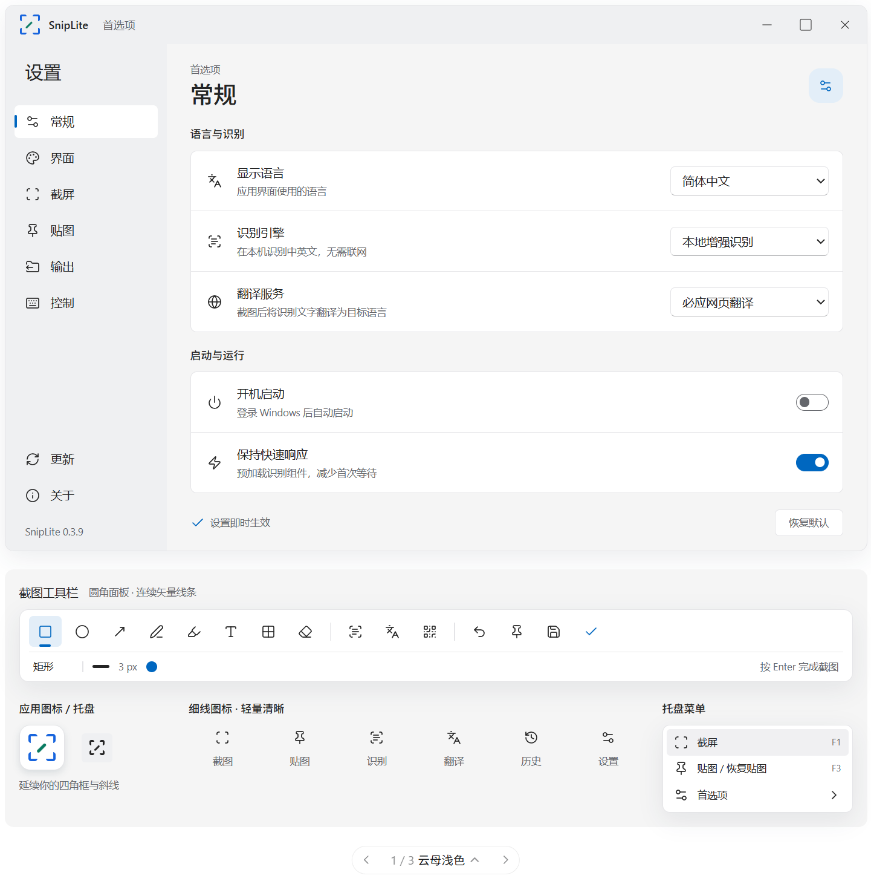

# SnipLite

**截图、标注、贴图、提取文字、翻译与识别二维码，在一个托盘小工具里完成。**

SnipLite 是一个基于 .NET 10 与 WinForms 的 Windows 桌面工具，交互灵感来自 Snipaste。按下快捷键，框选屏幕、添加标注，将图片复制或贴在桌面上；也可以直接从截图中选取文字、读取二维码内容。

Windows · 原生桌面界面 · 本地识别 · MIT

[源代码](https://github.com/GxDongV/SnipLite) · [问题反馈](https://github.com/GxDongV/SnipLite/issues) · [发布版本](https://github.com/GxDongV/SnipLite/releases)

## 界面预览

云母浅色风格设计预览，展示首选项、截图工具栏、应用图标与托盘菜单。



## 亮点

- **截图后直接识别文字**：工具栏内置 OCR，在原图上拖动选字，支持全选、复制，按 Esc 返回标注。默认使用 SimdPaddleOCR + PP-OCRv6 Small 本地模型，中英文自动识别，无需 API Key；也可切换 Windows 系统引擎。
- **二维码结果就地显示**：二维码及常见条码识别结果显示在工具栏下方，点击右侧按钮复制完整内容，长结果支持省略与悬停查看。
- **译文直接覆盖原文**：点击工具栏「译」，默认英语转中文，译文按文字块覆盖到截图原位置；完整工具栏保持可用，下方一行选择语言、查看翻译状态，通过独立图标切换原文与译文。
- **文字标注可以反复修改**：已有文字可再次点击编辑，定位插入、拖动选字、替换内容，支持字体、字号、粗体与斜体。工字形光标随字号调整，文字框可移动和缩放。
- **常用标注工具齐全**：矩形、椭圆、多种箭头、画笔、半透明马克笔、像素马赛克与橡皮擦，支持调色、大小调整及撤销、重做。
- **把参考图贴在桌面上**：图片置顶显示，拖动移动、滚轮缩放、调整透明度；支持隐藏与恢复贴图、贴图分组、缩略图和鼠标穿透，也可将剪贴板文字转成图片。
- **精细选区与取色**：窗口及可访问控件自动框选、全屏辅助十字线、像素放大镜、RGB / HEX 取色，拖动鼠标可随时自定义截图范围。
- **本地识别，可选在线翻译**：OCR、条码解码与图片处理均在本机完成；点击翻译时仅将提取的文字发送给所选翻译服务，不上传截图。

## 快速开始

### 从源码运行

开发环境需要 Windows 和 **.NET 10 SDK**。

```powershell
git clone https://github.com/GxDongV/SnipLite.git
cd SnipLite
dotnet build SnipLite.slnx -c Release
dotnet run --project src/SnipLite/SnipLite.csproj -c Release --no-build
```

也可双击仓库根目录的 `启动最新版.cmd`，脚本会先构建再启动。启动后程序常驻系统托盘，右键图标可打开首选项或退出；默认没有主窗口。

### 运行发布包

在 [Releases](https://github.com/GxDongV/SnipLite/releases) 选择 Windows x64 版本：

| 版本 | 使用方式 |
| --- | --- |
| `single.exe` 单文件版 | 下载一个 EXE 后直接运行 |
| `setup.exe` 安装版 | 通过向导安装，提供开始菜单快捷方式和卸载入口 |
| `portable.zip` 解压版 | 完整解压后运行 `SnipLite.exe` |

这三种发布包均包含 .NET 运行时，无需另外安装 .NET。单文件版首次启动会释放原生依赖。MIT 与第三方许可证可在「帮助 → 开源许可证」中离线查看。

开发脚本也支持生成较小的依赖框架包，这类包需要 **.NET 10 Desktop Runtime**。

当前目标系统最低为 Windows 10 2004（Build 19041）。实际可用性还取决于所用 .NET 运行时与系统组件。增强 OCR 模型随程序附带，首次使用时加载，无需联网下载；切换或回退到 Windows OCR 时需要系统安装相应的识别语言包。

## 常用操作

以下为默认绑定，可在「首选项 → 控制」修改全局快捷键。

| 操作 | 功能 |
| --- | --- |
| `F1` | 开始截图 |
| `F3` | 已有截图选区时直接贴出当前选区；平时贴出剪贴板图片或恢复贴图 |
| `Ctrl+Alt+O` | 框选后识别文字并复制 |
| `Ctrl+Alt+Q` | 框选识别二维码 / 条码，显示可复制结果 |
| 单击高亮区域 / 拖动鼠标 | 自动选区 / 自定义选区 |
| 鼠标右键 | 取消当前截图 |
| `Alt` / `C` | 显示放大镜 / 复制指针处颜色 |
| `Enter` / `Ctrl+C` | 确认当前截图 / 复制截图 |
| `Ctrl+S` / `Ctrl+T` | 另存为 / 将选区贴到桌面 |
| `Ctrl+Z` / `Ctrl+Y` | 撤销 / 重做标注 |

### 标注与识别

选区后通过工具栏使用矩形、椭圆、箭头、画笔、马克笔、文字、马赛克和橡皮擦。

文字工具下，单击已有文字即可继续编辑；按 Enter 提交，Shift+Enter 换行，Esc 取消本轮修改。拖动文字框边缘移动文字，右下角手柄用于缩放。

点击 **OCR** 后按钮保持选中，上方完整工具栏保留，下方另加状态行显示识别进度和划词提示。拖动选字、Ctrl+A 全选、Ctrl+C 复制；状态行「复制文字」复制选中文字，未选字时复制全部结果。再次点击 OCR 或按 Esc 返回编辑，点击其他标注工具可直接退出划词并切换工具。上方复制、保存和贴图按钮继续按截图功能执行。点击 **QR** 查看单行结果，点击「复制」复制完整内容，Esc 收起结果。识别模式中的快捷键优先作用于文字或识别结果。

在「首选项 → 常规 → 识别引擎」可切换增强识别与 Windows OCR。「系统识别语言」只作用于 Windows 引擎。增强引擎发生异常时自动尝试系统引擎；两种方式均在本机处理图片。OCR 划词允许在字符框边缘附近按下鼠标，拖动时吸附最近文字。

点击 **译** 后按钮保持选中，自动识别截图并将译文覆盖在原文位置，完整标注工具栏继续保留。下方只增加一行语言与翻译状态栏：首次默认英语 → 中文简体，之后记住语言选择；源语言可设为「自动检测语言」，双向箭头交换语言方向，眼睛图标切换原文/译文。改变语言复用识别结果，调整选区后重新识别翻译。

上方的复制截图、保存与贴图输出当前显示的画面，新标注显示在译文上方；下方复制图标复制当前原文或译文的文字。再次点击「译」或按 Esc 关闭翻译并恢复原图。网络错误或请求受限在状态栏提示，悬停可查看完整说明，点击重试图标重新翻译。

原位覆盖按照文字区域周围的背景颜色填充，再将译文缩放排入原区域，适合常见浅色/深色界面和纯色文字背景；复杂图片背景、旋转文字及特别密集的排版可能无法无痕还原背景。原图始终保留，切换显示不会修改源像素。

「首选项 → 常规 → 翻译服务」默认使用必应网页翻译，也可选择 Google、MyMemory 或 Microsoft Azure。必应和 Google 使用各自的网页接口，无需用户配置密钥，网页接口可能限流或变更。选择 Microsoft Azure 时，先填写 Azure Translator 资源的密钥和区域（全局 Translator 资源的区域可留空）。密钥由 Windows 按当前用户加密保存在本机。[微软接入文档](https://learn.microsoft.com/en-us/azure/cognitive-services/translator/quickstart-translator)

MyMemory 无需注册或配置密钥，使用时在翻译栏手动选择源语言。匿名额度为每天 5,000 字符，程序按单次最多 500 个 UTF-8 字节分段，并在额度用尽时提示。[额度说明](https://mymemory.translated.net/doc/usagelimits.php) · [API 文档](https://mymemory.translated.net/doc/spec.php)

首选项设置默认翻译服务。截图后也可以点击翻译栏上的服务名称切换本次截图的服务，程序用已识别的文字重新翻译。

翻译需要联网，截图中识别出的文字发送给所选服务。普通 OCR 在本机运行。

### 贴图

截图选区确定后按 F3，直接将当前选区（包含标注及当前显示的译文）贴到桌面，作用与工具栏贴图按钮一致。未打开截图时，F3 优先恢复隐藏贴图；剪贴板更新后可以贴出新图片。

拖动贴图移动位置，滚轮缩放，Ctrl+滚轮调整透明度，Ctrl+0 恢复原始大小。右键菜单提供复制、保存、识别及贴图管理功能。

## 首选项与数据

界面采用 Windows 11 风格的侧边导航、圆角设置卡片和矢量线条图标，自动跟随 Windows 的浅色 / 深色模式，运行中切换无需重启。默认托盘图标单独跟随任务栏的明暗设置；也可继续选择彩色或自定义图标。

首选项支持主题色、界面字体、放大镜、自动选区、截图动作、贴图行为、保存路径、文件名模板、快捷键与冲突提示等设置，修改后即时保存。

托盘右键 →「帮助」可查看项目来源，并直接点击 GitHub 仓库地址或问题反馈链接；「更新」页提供发布版本入口。

| 数据 | 默认位置 / 行为 |
| --- | --- |
| 设置 | `%APPDATA%\SnipLite\settings.json`，可在首选项中迁移 |
| 应用日志 | `%LOCALAPPDATA%\SnipLite\app.log`，日志级别可配置 |
| 异常日志 | `%TEMP%\SnipLite\error.log` |
| 截图文件 | 默认通过复制或手动保存输出，自动保存可在首选项中开启 |
| 截图及贴图历史 | 当前运行会话内保留，退出后不恢复 |

## 构建与发布

构建整个解决方案：

```powershell
dotnet build SnipLite.slnx -c Release
```

生成 Windows x64 发布目录：

```powershell
# 需要目标机器安装 .NET 10 Desktop Runtime
.\scripts\publish.ps1

# 包含运行时，可在目标机器上独立运行
.\scripts\publish.ps1 -SelfContained

# 单文件独立运行包
.\scripts\publish.ps1 -SingleFile
```

输出位于 `artifacts/publish/win-x64/`，发布脚本会附带 README、项目许可证与第三方声明。清理所有构建和打包产物：

```powershell
.\scripts\clean.ps1
```

同时生成三个发布包及 SHA-256 校验文件，需要安装 [Inno Setup](https://jrsoftware.org/isinfo.php)：

```powershell
.\scripts\release.ps1 -IsccPath 'C:\Program Files (x86)\Inno Setup 6\ISCC.exe'
```

产物位于 `artifacts/release/<版本号>/`，不会提交到源码仓库。

## 项目结构

```text
SnipLite.slnx
src/SnipLite/             正式程序：截图、标注、识别、贴图与首选项
tests/SnipLite.SelfTest/  独立的 Windows 桌面回归与渲染诊断程序
scripts/                 发布与清理脚本
docs/                    开发说明
licenses/                第三方许可证与声明
```

测试程序与正式程序分开构建，发布包不包含测试入口、测试图片或实测报告。开发与验证方法见 [开发说明](docs/DEVELOPMENT.md)。


## 参与开发

欢迎通过 Issue 反馈问题，或通过 Pull Request 改进功能。反馈时请提供程序版本、Windows 版本、屏幕缩放比例、复现步骤和相关日志；截图可仅保留与问题有关的区域。

## 许可证与致谢

项目源码采用 [MIT License](LICENSE)。二维码与条码解码使用 [ZXing.Net](https://github.com/micjahn/ZXing.Net)，相关依赖声明见 [THIRD_PARTY_NOTICES.md](THIRD_PARTY_NOTICES.md)。OCR 使用 Windows 系统组件。

SnipLite 与 Snipaste 没有隶属关系；Snipaste 名称及其相关权利归原权利人所有。
