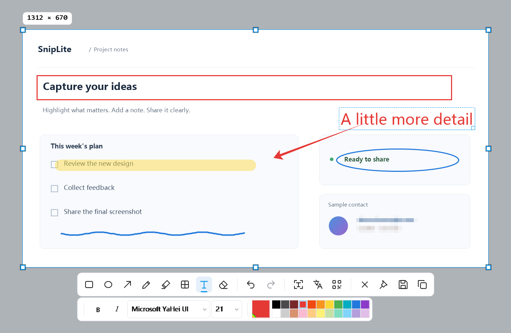
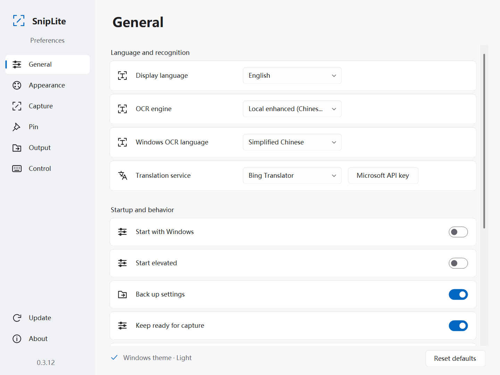

# SnipLite

<!-- languages:start -->
**English** · [简体中文](docs/README.zh-CN.md) · [繁體中文](docs/README.zh-TW.md) · [日本語](docs/README.ja.md) · [한국어](docs/README.ko.md) · [Français](docs/README.fr.md) · [Deutsch](docs/README.de.md) · [Español](docs/README.es.md)
<!-- languages:end -->

**Capture, annotate, pin, recognize text, translate and scan QR codes from one Windows tray tool.**

SnipLite is a Windows screenshot tool inspired by Snipaste. Capture a region or an automatically detected window, annotate it, copy it, or pin it above other windows.

[Source](https://github.com/GxDongV/SnipLite) · [Downloads](https://github.com/GxDongV/SnipLite/releases) · [Issues](https://github.com/GxDongV/SnipLite/issues)

## Preview

### Capture and annotate

Annotation example with rectangles, ellipses, arrows, pen, highlighter, editable text and pixel mosaic, using the current application's toolbar and drawing tools.

### Preferences

Preferences in English, rendered from the current application in light mode.

## Features

- **Scrolling screenshots:** press F1, select the content, and choose the scrolling screenshot icon. The bundled plugin scrolls and stitches the capture, then opens a preview for cropping, saving, copying, or pinning.
- **Local OCR:** recognize everyday Chinese / English text offline and select words directly on the capture to copy them.
- **QR codes and barcodes:** results appear below the toolbar, with a copy button.
- **Screenshot translation:** overlay translated text on the original regions. Switch the provider and language pair, swap languages, retry, or toggle the original without leaving the capture.
- **Editable annotations:** rectangles, ellipses, arrow styles, pen, translucent highlighter, pixel mosaic and eraser. Re-edit text, change its font and size, move and resize it, undo and redo.
- **Pinned images:** always-on-top references, zoom, opacity, thumbnails, groups, hide / restore and click-through. Pin clipboard images or render clipboard text as an image.
- **Precise selection:** detect windows and accessible UI elements, select by click or drag, use the fullscreen crosshair and pixel magnifier, and copy RGB / HEX colors.
- **Eight interface languages:** follow the Windows display language by default or choose a language manually. Light / dark themes follow Windows too.

## Download and run

Get a Windows x64 package from [Releases](https://github.com/GxDongV/SnipLite/releases).

| Package | Usage |
| --- | --- |
| `single.exe` | Run the single executable |
| `setup.exe` | Install with a wizard, Start menu shortcut and uninstaller |
| `portable.zip` | Extract the entire archive, then run `SnipLite.exe` |

All three include the .NET runtime. The single-file version extracts native dependencies when needed. The application runs in the system tray; right-click its icon for preferences and exit. The current project targets Windows 10 2004 / build 19041 or later; runtime and system component compatibility also applies.

## Plugins

SnipLite v0.3.17 bundles Scroll Capture 0.1.6 in all three packages and enables it by default.

- **Install or update.** In **Preferences → Plugins**, choose **Import plugin…** for a downloaded `.snipplugin` file or **Download plugin…** for an HTTPS package URL. Enable newly installed plugins from the list. Restart SnipLite to apply an update.
- **Manage.** In **Installed plugins**, use the switch to enable or disable a plugin. Choose **Uninstall plugin** at the right end of its row and confirm. For an updated Scroll Capture installation, choose **Restore bundled version** to roll back. Uninstall, update and restore take effect on restart and keep plugin settings and hotkeys.
- **Browse in the app.** Open **Preferences → Plugins → Discover plugins** to browse, install or update plugins from the official catalog.

### Official plugin list

| Category | Plugin | Version | Requires SnipLite | Download |
| --- | --- | --- | --- | --- |
| Capture | [Scroll Capture](https://github.com/GxDongV/SnipLite-Plugin-Catalog/tree/main/plugins/capture/scroll-capture) | 0.1.7 | 0.3.16 or later | [`.snipplugin`](https://github.com/GxDongV/SnipLite-Plugin-Catalog/releases/download/scroll-capture-v0.1.7/sniplite.scroll-capture-0.1.7.snipplugin) |

[Official plugin catalog](https://github.com/GxDongV/SnipLite-Plugin-Catalog) · [Plugin integration specification (Simplified Chinese)](docs/PLUGIN_DEVELOPMENT.zh-CN.md)

## Default controls

| Control | Action |
| --- | --- |
| `F1` | Start capture |
| `F3` | Pin the current selection; otherwise pin clipboard content or restore a pin |
| `Ctrl+Alt+O` | Select a region, recognize and copy text |
| `Ctrl+Alt+Q` | Select a region and scan QR / barcodes |
| Click highlighted region / drag | Automatic / custom selection |
| Right-click / `Esc` | Cancel or leave the active recognition mode |
| `Alt` / `C` | Magnifier / copy color at pointer |
| `Enter` / `Ctrl+C` | Confirm / copy capture |
| `Ctrl+S` / `Ctrl+T` | Save as / pin selection |
| `Ctrl+Z` / `Ctrl+Y` | Undo / redo |

## OCR, translation and pinning

Click **OCR** after selecting a region. Drag over the recognized text, use `Ctrl+A` to select all, then `Ctrl+C` to copy. Recognition status appears below the toolbar; `Esc` returns to annotation without discarding the capture.

Click **Translate** to place translated text over the original. The default direction is English → Simplified Chinese; later language choices are remembered. The row below the toolbar lets you change the service, swap languages, retry, copy text, or toggle the original. Copying, saving or pinning the image exports the currently visible view.

Press **F3** to pin the current selection, including annotations and any visible translation. Drag a pinned image to move it, use the wheel to zoom, `Ctrl` + wheel to adjust opacity, and `Ctrl+0` to restore its original size. Right-click for groups, thumbnails and click-through. Hidden or closed pins can be restored during the current session.

## Interface language

Open **Preferences → General → Display language**. Choose Follow system, English, 简体中文, 繁體中文, 日本語, 한국어, Français, Deutsch or Español. Changes apply immediately; existing captures, annotations and recognition content are retained.

New settings follow the Windows **display language**, not regional formatting. Unsupported languages fall back to English; existing saved language choices are preserved. All interface resources are bundled and work offline. Interface language, OCR language and translation languages are independent. An eight-language interface does not imply eight-language support in the enhanced OCR model.

## Translation and privacy

OCR, QR decoding and image processing run locally. Enhanced OCR models ship with the application.
Translation sends only recognized text to the selected service; it does not upload the screenshot. Bing web translation is the default. Google and Bing web endpoints require no user API key but can change or be rate-limited. MyMemory also supports anonymous usage, with service quotas and an explicit source language. Microsoft Azure requires your own Translator key and, where applicable, region; credentials are encrypted for the current Windows user. Service availability and fees depend on the provider and account.

## Settings and data

Settings are saved immediately. Configure hotkeys, fonts, accent, capture behavior, pinned images and output in Preferences. Help links directly to this repository, issues and licenses.

| Data | Default location / behavior |
| --- | --- |
| Settings | `%APPDATA%\SnipLite\settings.json`; can be relocated in Preferences |
| Application log | `%LOCALAPPDATA%\SnipLite\app.log`; configurable log level |
| Crash log | `%TEMP%\SnipLite\error.log` |
| Images | Copy or save manually; optional automatic saving |
| Capture / pin history | Current session only |

## Feedback and license

Report issues through [GitHub Issues](https://github.com/GxDongV/SnipLite/issues), including the app version, Windows version, display scaling and reproduction steps. Feedback on translations is welcome too.

[MIT](LICENSE). Local OCR uses [SimdPaddleOCR](https://github.com/sdcb/SimdPaddleOCR) / PP-OCRv6 Small. QR / barcode decoding uses [ZXing.Net](https://github.com/micjahn/ZXing.Net). See [third-party notices](THIRD_PARTY_NOTICES.md). SnipLite is not affiliated with Snipaste.
