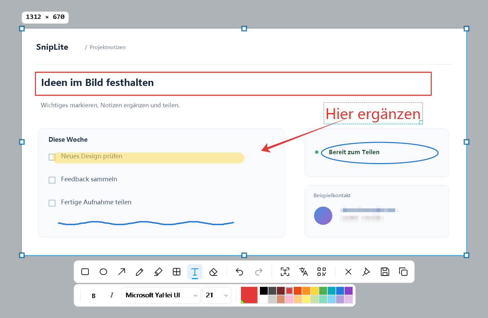
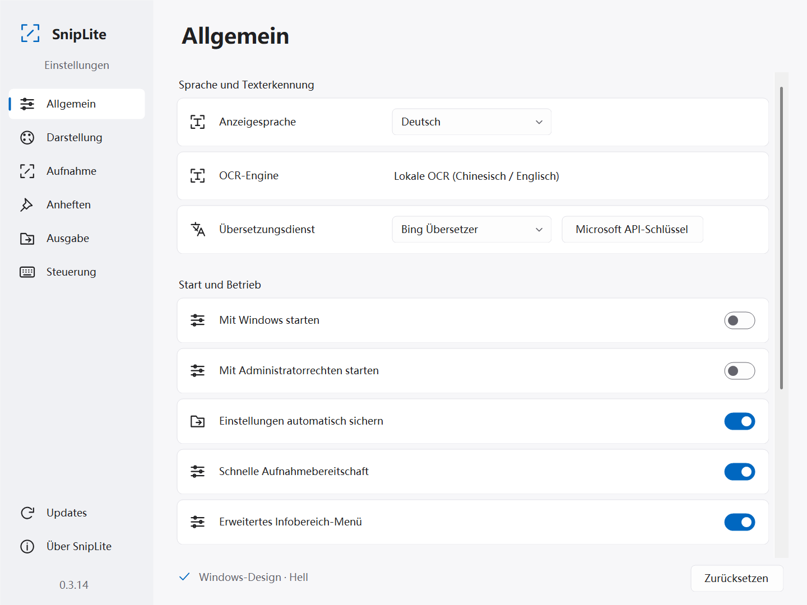

# SnipLite

<!-- languages:start -->
[English](../README.md) · [简体中文](README.zh-CN.md) · [繁體中文](README.zh-TW.md) · [日本語](README.ja.md) · [한국어](README.ko.md) · [Français](README.fr.md) · **Deutsch** · [Español](README.es.md)
<!-- languages:end -->

**Screenshots, Anmerkungen, angeheftete Bilder, OCR, Übersetzung und QR-Erkennung in einem Windows-Werkzeug.**

SnipLite ist ein Screenshot-Werkzeug für Windows. Die Bedienung ist von Snipaste inspiriert: Bereich auswählen, Anmerkungen hinzufügen und das Bild kopieren oder über anderen Fenstern anheften.

[Quellcode](https://github.com/GxDongV/SnipLite) · [Downloads](https://github.com/GxDongV/SnipLite/releases) · [Fehler melden](https://github.com/GxDongV/SnipLite/issues)

## Vorschau

### Aufnehmen und markieren

Beispiel mit der Werkzeugleiste und den Zeichenwerkzeugen der aktuellen Anwendung: Rechtecke, Ellipsen, Pfeile, Stift, Textmarker, bearbeitbarer Text und Pixelmosaik.

### Einstellungen

Einstellungen der aktuellen Anwendung auf Deutsch im hellen Design.

## Funktionen

- Automatische Erkennung von Fenstern und zugänglichen UI-Elementen; Auswahl per Klick oder Ziehen.
- Rechtecke, Ellipsen, Pfeile, Stift, Textmarker, Pixelmosaik und Radierer. Text lässt sich erneut bearbeiten, verschieben und skalieren.
- Lokale OCR mit SimdPaddleOCR + PP-OCRv6 Small für alltägliche chinesische und englische Texte.
- Erkannten Text direkt auf dem Screenshot auswählen und kopieren. QR- und Barcode-Ergebnisse erscheinen unter der Werkzeugleiste.
- Übersetzungen an der Position des Originaltexts einblenden. Dienst, Sprachrichtung und Originalansicht lassen sich wechseln.
- Bilder im Vordergrund anheften, zoomen, Transparenz ändern, gruppieren, verkleinern, ausblenden und wiederherstellen; Mausklicks können durchgereicht werden.
- Pixellupe, bildschirmweites Fadenkreuz, RGB-/HEX-Farbwerte sowie helle und dunkle Windows-Designs.

## Download

Ein Windows-x64-Paket unter [Releases](https://github.com/GxDongV/SnipLite/releases) auswählen.

| Datei | Verwendung |
| --- | --- |
| `single.exe` | Ausführbare Datei direkt starten |
| `setup.exe` | Mit dem Installationsassistenten installieren |
| `portable.zip` | Vollständig entpacken und `SnipLite.exe` starten |

Alle drei enthalten die .NET-Laufzeit. Die Anwendung läuft im Infobereich; ein Rechtsklick öffnet die Einstellungen oder beendet sie. Das Projekt zielt auf Windows 10 2004 / Build 19041 und neuer. Die Anforderungen der Laufzeit und Systemkomponenten gelten zusätzlich.

## Standardbedienung

| Taste | Aktion |
| --- | --- |
| `F1` | Screenshot starten |
| `F3` | Auswahl anheften; sonst Zwischenablage verwenden oder ein Bild wiederherstellen |
| `Ctrl+Alt+O` / `Ctrl+Alt+Q` | Bereich für OCR / QR-Erkennung auswählen |
| `Alt` / `C` | Lupe / Farbe am Mauszeiger kopieren |
| `Enter` / `Ctrl+C` | Bestätigen / kopieren |
| `Ctrl+S` / `Ctrl+T` | Speichern unter / anheften |
| Rechtsklick / `Esc` | Abbrechen oder Erkennungsmodus verlassen |

## OCR, Übersetzung und angeheftete Bilder

Bereich auswählen, **OCR** anklicken und den erkannten Text durch Ziehen markieren. `Ctrl+A` wählt alles aus, `Ctrl+C` kopiert und `Esc` führt zur Bearbeitung zurück. QR-Ergebnisse erscheinen in der unteren Zeile mit einer Kopierschaltfläche rechts.

Die Übersetzung wird über dem Originaltext angezeigt. In der unteren Zeile lassen sich Dienst und Sprachen auswählen sowie Original und Übersetzung umschalten. Kopieren, Speichern und Anheften übernehmen die gerade angezeigte Ansicht.

Mit `F3` wird die Auswahl angeheftet. Angeheftete Bilder lassen sich ziehen, mit dem Mausrad zoomen und mit `Ctrl` + Mausrad transparenter machen. `Ctrl+0` stellt die Originalgröße wieder her. Das Kontextmenü bietet Gruppen, Miniaturen und das Durchreichen von Mausklicks.

## Oberflächensprache

Beim ersten Start verwendet SnipLite die Windows-Anzeigesprache. Unter **Einstellungen → Allgemein → Anzeigesprache** stehen die automatische Auswahl und acht Sprachen bereit. Änderungen wirken sofort; Bilder, Anmerkungen und Erkennungsergebnisse bleiben erhalten. Nicht unterstützte Sprachen verwenden Englisch. Bereits gespeicherte Sprachoptionen bleiben bestehen.

Alle Sprachressourcen sind enthalten und offline verfügbar. Oberflächensprache, OCR-Sprache und Übersetzungssprachen sind unabhängig voneinander. Die deutsche Oberfläche erweitert nicht die Sprachen des verbesserten OCR-Modells.

## Übersetzung und Daten

OCR, QR-Erkennung und Bildverarbeitung laufen lokal. Beim Übersetzen wird nur der erkannte Text an den gewählten Dienst gesendet, kein Screenshot. Voreingestellt sind Bing und Englisch → vereinfachtes Chinesisch. Google, MyMemory und Microsoft Azure stehen ebenfalls zur Verfügung. Azure benötigt einen eigenen API-Schlüssel; für andere Dienste können Kontingente und Änderungen gelten.

Einstellungen liegen unter `%APPDATA%\SnipLite\settings.json`. Der Verlauf von Screenshots und angehefteten Bildern besteht nur während der aktuellen Sitzung.

## Rückmeldungen und Lizenz

Probleme und Vorschläge können über [GitHub Issues](https://github.com/GxDongV/SnipLite/issues) gemeldet werden. Bitte App- und Windows-Version, Anzeigeskalierung und Schritte zur Reproduktion angeben.

[MIT](../LICENSE) · [Drittanbieter-Lizenzen](../THIRD_PARTY_NOTICES.md)

OCR nutzt SimdPaddleOCR / PP-OCRv6 Small; die Code-Erkennung nutzt ZXing.Net. SnipLite ist nicht mit Snipaste verbunden.
