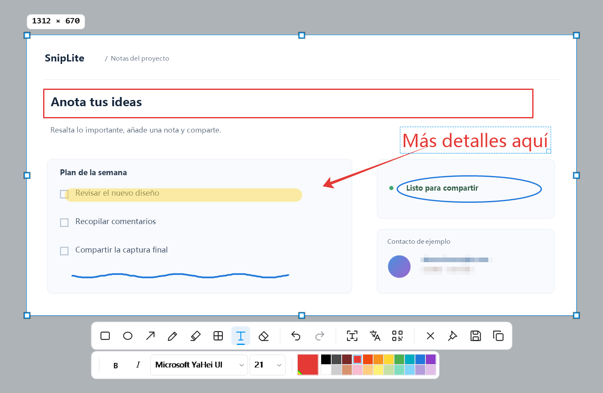
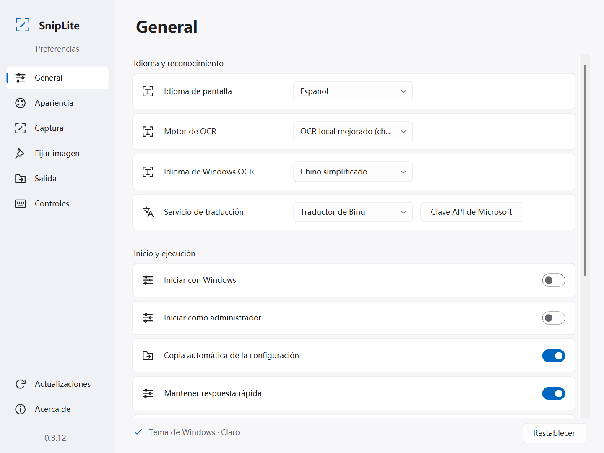

# SnipLite

<!-- languages:start -->
[English](../README.md) · [简体中文](README.zh-CN.md) · [繁體中文](README.zh-TW.md) · [日本語](README.ja.md) · [한국어](README.ko.md) · [Français](README.fr.md) · [Deutsch](README.de.md) · **Español**
<!-- languages:end -->

**Capturas, anotaciones, imágenes fijadas, OCR, traducción y lectura de códigos QR en una sola herramienta para Windows.**

SnipLite es una herramienta de capturas para Windows, con una interacción inspirada en Snipaste. Selecciona una zona, añade anotaciones y copia la imagen o fíjala por encima de otras ventanas.

[Código fuente](https://github.com/GxDongV/SnipLite) · [Descargas](https://github.com/GxDongV/SnipLite/releases) · [Informar de un problema](https://github.com/GxDongV/SnipLite/issues)

## Vista previa

### Captura y anotación

Ejemplo con la barra de herramientas y las herramientas de dibujo de la aplicación actual: rectángulos, elipses, flechas, lápiz, resaltador, texto editable y mosaico de píxeles.

### Preferencias

Preferencias de la aplicación actual en español, en modo claro.

## Funciones

- Detección automática de ventanas y elementos de interfaz accesibles; selección con un clic o arrastrando.
- Rectángulos, elipses, flechas, lápiz, resaltador, mosaico de píxeles y borrador. El texto se puede volver a editar, mover y redimensionar.
- OCR local con SimdPaddleOCR + PP-OCRv6 Small para textos habituales en chino e inglés, con Windows OCR como alternativa.
- Selección y copia del texto reconocido sobre la captura. Los resultados QR y de códigos de barras aparecen debajo de la barra de herramientas.
- Traducción superpuesta en la posición original, con selección de servicio e idiomas y cambio entre original y traducción.
- Imágenes fijadas, zoom, opacidad, miniaturas, grupos, ocultación, restauración y paso de clics del ratón.
- Lupa de píxeles, cruz de pantalla completa, colores RGB / HEX y temas claro y oscuro de Windows.

## Descarga

Elige un paquete para Windows x64 en [Releases](https://github.com/GxDongV/SnipLite/releases).

| Archivo | Uso |
| --- | --- |
| `single.exe` | Ejecutar el archivo directamente |
| `setup.exe` | Instalar con el asistente |
| `portable.zip` | Extraer todo y ejecutar `SnipLite.exe` |

Los tres incluyen el entorno de ejecución .NET. La aplicación permanece en la bandeja del sistema; un clic derecho permite abrir las preferencias o salir. El proyecto está dirigido a Windows 10 2004 / compilación 19041 y posteriores, sujeto también a los requisitos del entorno y los componentes del sistema.

## Controles predeterminados

| Tecla | Acción |
| --- | --- |
| `F1` | Iniciar captura |
| `F3` | Fijar la selección; si no hay selección, usar el portapapeles o restaurar una imagen |
| `Ctrl+Alt+O` / `Ctrl+Alt+Q` | Seleccionar una zona para OCR / lectura QR |
| `Alt` / `C` | Lupa / copiar el color bajo el puntero |
| `Enter` / `Ctrl+C` | Confirmar / copiar |
| `Ctrl+S` / `Ctrl+T` | Guardar como / fijar |
| Clic derecho / `Esc` | Cancelar o salir del modo de reconocimiento |

## OCR, traducción e imágenes fijadas

Selecciona una zona y pulsa **OCR**; después arrastra sobre el texto reconocido. `Ctrl+A` selecciona todo, `Ctrl+C` copia y `Esc` vuelve a las anotaciones. Los resultados QR aparecen en la fila inferior con un botón de copia a la derecha.

El botón de traducción superpone el texto traducido al original. La fila inferior permite elegir el servicio y los idiomas, y alternar entre original y traducción. Al copiar, guardar o fijar la imagen se utiliza la vista actual.

Pulsa `F3` para fijar la selección. Arrastra una imagen fijada para moverla, usa la rueda para el zoom, `Ctrl` + rueda para la opacidad y `Ctrl+0` para restaurar el tamaño original. El menú contextual ofrece grupos, miniaturas y paso de clics.

## Idioma de la interfaz

En el primer inicio se utiliza el idioma de pantalla de Windows. En **Preferencias → General → Idioma de pantalla** puedes elegir el modo automático o uno de los ocho idiomas. El cambio es inmediato y conserva las imágenes, las anotaciones y los resultados. Los idiomas no disponibles usan inglés. Se conservan las preferencias guardadas en versiones anteriores.

Los recursos se incluyen con la aplicación y funcionan sin conexión. El idioma de la interfaz, el del OCR y los idiomas de traducción son independientes. Elegir español no añade idiomas al modelo OCR mejorado.

## Traducción y datos

El OCR, la lectura QR y el procesamiento de imágenes son locales. Al traducir, solo se envía el texto extraído al servicio seleccionado, sin subir la captura. El servicio inicial es Bing y la dirección inicial inglés → chino simplificado. También se ofrecen Google, MyMemory y Microsoft Azure. Azure necesita tu propia clave API; los demás servicios pueden imponer cuotas o cambiar sus interfaces.

La configuración se guarda en `%APPDATA%\SnipLite\settings.json`. El historial de capturas e imágenes fijadas solo se conserva durante la sesión actual.

## Comentarios y licencia

Envía problemas y sugerencias a [GitHub Issues](https://github.com/GxDongV/SnipLite/issues), indicando la versión de la aplicación y de Windows, la escala de pantalla y los pasos para reproducirlos.

[MIT](../LICENSE) · [Licencias de terceros](../THIRD_PARTY_NOTICES.md)

El OCR utiliza SimdPaddleOCR / PP-OCRv6 Small y Windows OCR; la lectura de códigos utiliza ZXing.Net. SnipLite no está afiliado a Snipaste.
