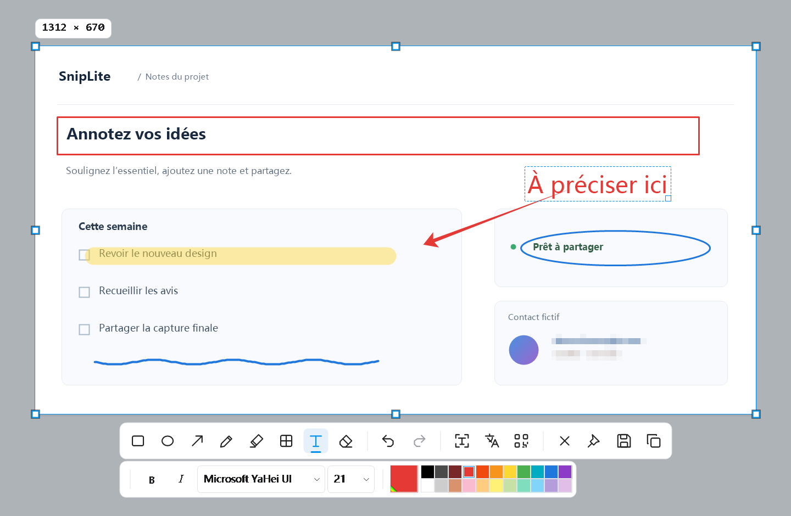
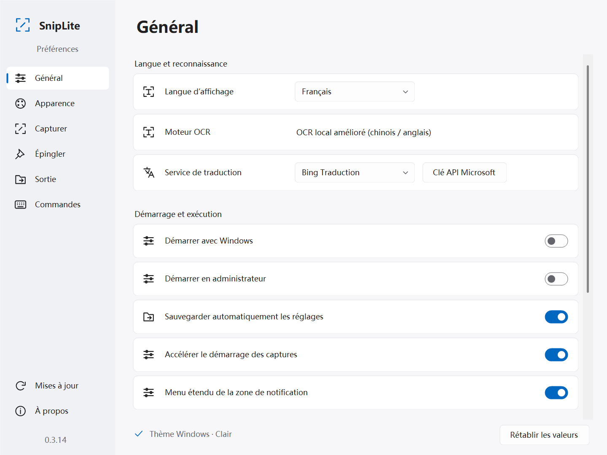

# SnipLite

<!-- languages:start -->
[English](../README.md) · [简体中文](README.zh-CN.md) · [繁體中文](README.zh-TW.md) · [日本語](README.ja.md) · [한국어](README.ko.md) · **Français** · [Deutsch](README.de.md) · [Español](README.es.md)
<!-- languages:end -->

**Capture, annotation, épinglage, OCR, traduction et lecture de codes QR dans un seul outil Windows.**

SnipLite est un outil de capture pour Windows, dont les interactions s’inspirent de Snipaste. Sélectionnez une zone, ajoutez des annotations, puis copiez l’image ou épinglez-la au-dessus des autres fenêtres.

[Code source](https://github.com/GxDongV/SnipLite) · [Téléchargements](https://github.com/GxDongV/SnipLite/releases) · [Signaler un problème](https://github.com/GxDongV/SnipLite/issues)

## Aperçu

### Capture et annotation

Exemple réalisé avec la barre d’outils et les outils de dessin de l’application actuelle : rectangles, ellipses, flèches, stylo, surligneur, texte modifiable et mosaïque de pixels.

### Préférences

Préférences de l’application actuelle en français, en mode clair.

## Fonctionnalités

- Détection des fenêtres et des éléments d’interface accessibles ; sélection par clic ou glissement.
- Rectangles, ellipses, flèches, stylo, surligneur, mosaïque et gomme. Le texte reste modifiable, déplaçable et redimensionnable.
- OCR local avec SimdPaddleOCR + PP-OCRv6 Small pour un usage courant en chinois et en anglais.
- Sélection et copie du texte directement sur la capture. Les résultats QR et codes-barres apparaissent sous la barre d’outils.
- Traduction superposée au texte original ; choix du service et des langues, inversion du sens et bascule original / traduction.
- Images épinglées au premier plan, zoom, opacité, miniatures, groupes, masquage, restauration et clics traversants.
- Loupe de pixels, réticule plein écran, copie des couleurs RGB / HEX et thèmes clair / sombre de Windows.

## Installation

Choisissez un paquet Windows x64 dans les [Releases](https://github.com/GxDongV/SnipLite/releases).

| Fichier | Utilisation |
| --- | --- |
| `single.exe` | Lancer directement l’exécutable |
| `setup.exe` | Installer avec l’assistant |
| `portable.zip` | Tout extraire, puis lancer `SnipLite.exe` |

Les trois incluent le runtime .NET. L’application reste dans la zone de notification ; un clic droit ouvre les préférences ou permet de quitter. Le projet cible Windows 10 2004 / build 19041 et versions ultérieures, sous réserve des exigences du runtime et des composants système.

## Commandes par défaut

| Touche | Action |
| --- | --- |
| `F1` | Commencer une capture |
| `F3` | Épingler la sélection ; sinon utiliser le presse-papiers ou restaurer une image |
| `Ctrl+Alt+O` / `Ctrl+Alt+Q` | Sélectionner une zone pour l’OCR / la lecture QR |
| `Alt` / `C` | Loupe / copier la couleur sous le pointeur |
| `Enter` / `Ctrl+C` | Valider / copier |
| `Ctrl+S` / `Ctrl+T` | Enregistrer sous / épingler |
| Clic droit / `Esc` | Annuler ou quitter le mode de reconnaissance |

## OCR, traduction et images épinglées

Sélectionnez une zone et cliquez sur **OCR**, puis faites glisser le pointeur sur le texte reconnu. `Ctrl+A` sélectionne tout, `Ctrl+C` copie et `Esc` revient aux annotations. Les résultats QR apparaissent dans la ligne du bas avec un bouton de copie à droite.

Le bouton de traduction superpose le texte traduit à l’original. La ligne inférieure permet de choisir le service et les langues, puis de basculer entre original et traduction. La copie, l’enregistrement et l’épinglage de l’image utilisent la vue affichée.

Appuyez sur `F3` pour épingler la sélection. Faites glisser une image pour la déplacer, utilisez la molette pour zoomer, `Ctrl` + molette pour l’opacité et `Ctrl+0` pour retrouver la taille originale. Le menu contextuel propose les groupes, les miniatures et les clics traversants.

## Langue de l’interface

Au premier lancement, SnipLite suit la langue d’affichage de Windows. Dans **Préférences → Général → Langue d’affichage**, choisissez le mode automatique ou l’une des huit langues. Le changement est immédiat et conserve les images en cours, les annotations et les résultats. Les langues non prises en charge utilisent l’anglais. Les choix enregistrés dans les anciennes versions sont conservés.

Les ressources sont incluses et fonctionnent hors ligne. La langue de l’interface, celle de l’OCR et les langues de traduction sont indépendantes. Une interface en français n’ajoute pas le français au modèle OCR amélioré.

## Traduction et données

L’OCR, les codes QR et le traitement d’image sont locaux. La traduction envoie uniquement le texte extrait au service choisi, sans téléverser la capture. Le service initial est Bing et le sens initial anglais → chinois simplifié. Google, MyMemory et Microsoft Azure sont également proposés. Azure exige votre propre clé API ; les autres services peuvent appliquer des quotas ou modifier leurs interfaces.

Les paramètres sont enregistrés dans `%APPDATA%\SnipLite\settings.json`. L’historique des captures et des images épinglées est limité à la session en cours.

## Retours et licence

Signalez les problèmes ou suggestions dans [GitHub Issues](https://github.com/GxDongV/SnipLite/issues), avec les versions de l’application et de Windows, la mise à l’échelle et les étapes de reproduction.

[MIT](../LICENSE) · [Licences tierces](../THIRD_PARTY_NOTICES.md)

L’OCR utilise SimdPaddleOCR / PP-OCRv6 Small ; le décodage utilise ZXing.Net. SnipLite n’est pas affilié à Snipaste.
