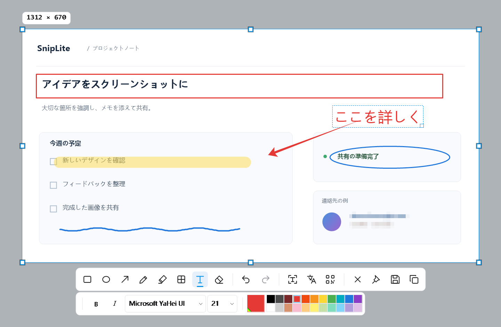
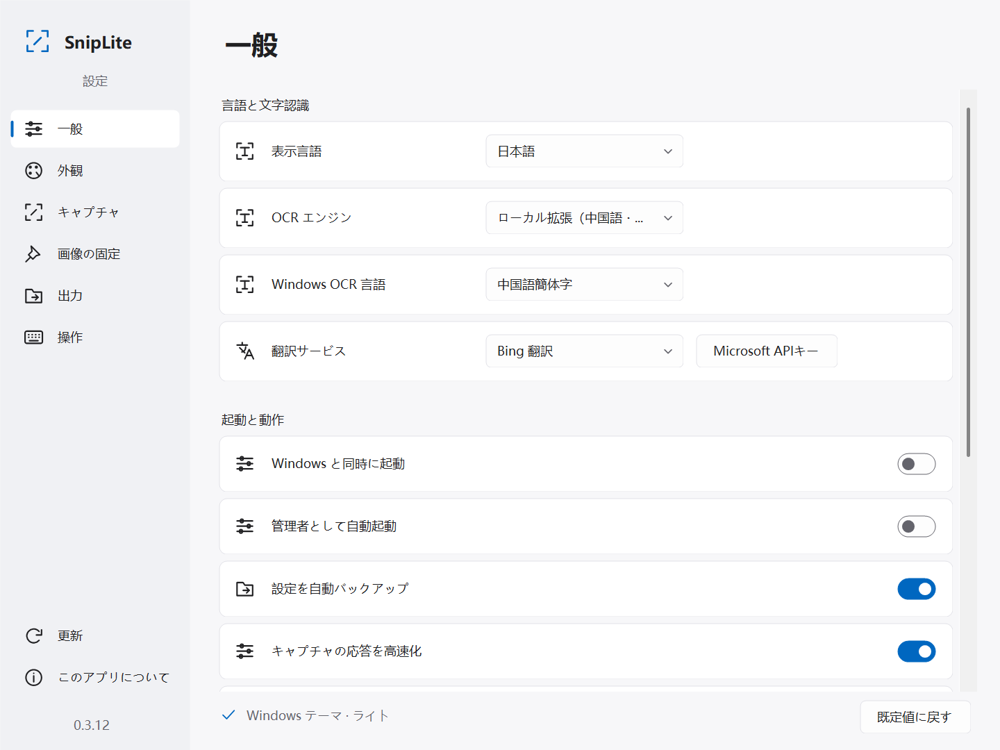

# SnipLite

<!-- languages:start -->
[English](../README.md) · [简体中文](README.zh-CN.md) · [繁體中文](README.zh-TW.md) · **日本語** · [한국어](README.ko.md) · [Français](README.fr.md) · [Deutsch](README.de.md) · [Español](README.es.md)
<!-- languages:end -->

**スクリーンショット、注釈、画像の固定、OCR、翻訳、QR コードの読み取りを、ひとつの Windows ツールで。**

SnipLite は Windows 用のスクリーンショット・画像固定ツールです。Snipaste に着想を得た操作で、画面の範囲を選択して注釈を付け、コピーしたり最前面に固定したりできます。

[ソースコード](https://github.com/GxDongV/SnipLite) · [ダウンロード](https://github.com/GxDongV/SnipLite/releases) · [不具合の報告](https://github.com/GxDongV/SnipLite/issues)

## プレビュー

### スクリーンショットと注釈

現在のアプリのツールバーと描画ツールを使った注釈の例。長方形、楕円、矢印、ペン、蛍光ペン、編集可能なテキスト、ピクセルモザイクを表示しています。

### 設定

現在のアプリの日本語設定画面（ライトモード）。

## 主な機能

- ウィンドウやアクセシビリティ対応の UI 要素を自動検出。クリックでもドラッグでも範囲を選択できます。
- 長方形、楕円、矢印、ペン、蛍光ペン、ピクセルモザイク、消しゴム。テキストは再編集、移動、サイズ変更が可能です。
- SimdPaddleOCR + PP-OCRv6 Small によるローカル OCR。日常的な中国語・英語の読み取り向けで、Windows OCR にも切り替えられます。
- 認識した文字を画像上で選択してコピー。QR コードとバーコードの結果はツールバーの下に表示します。
- 翻訳文を元の文字の位置に重ねて表示。サービス、言語、原文・訳文表示を切り替えられます。
- 画像の最前面固定、ズーム、透明度、サムネイル、グループ、非表示・復元、マウス操作の透過。
- ピクセル拡大鏡、全画面の十字線、RGB / HEX の取得。Windows のライト・ダークテーマに対応。

## ダウンロード

[Releases](https://github.com/GxDongV/SnipLite/releases) から Windows x64 版を選択してください。

| ファイル | 使い方 |
| --- | --- |
| `single.exe` | 実行ファイルを直接起動 |
| `setup.exe` | ウィザードでインストール |
| `portable.zip` | 全体を展開して `SnipLite.exe` を起動 |

いずれも .NET ランタイムを含みます。起動後はシステムトレイに常駐し、右クリックで設定や終了を選べます。対象は Windows 10 2004 / ビルド 19041 以降です。ランタイムとシステムコンポーネントの動作条件も適用されます。

## 基本操作

| キー | 操作 |
| --- | --- |
| `F1` | スクリーンショットを開始 |
| `F3` | 現在の選択範囲を固定。選択中でなければクリップボードから固定、または以前の画像を復元 |
| `Ctrl+Alt+O` / `Ctrl+Alt+Q` | 範囲を選択して OCR / QR 認識 |
| `Alt` / `C` | 拡大鏡 / ポインター位置の色をコピー |
| `Enter` / `Ctrl+C` | 確定 / コピー |
| `Ctrl+S` / `Ctrl+T` | 名前を付けて保存 / 固定 |
| 右クリック / `Esc` | キャンセル、または認識モードを終了 |

## OCR・翻訳・画像の固定

範囲を選択して **OCR** をクリックすると、画像上で文字をドラッグして選択できます。`Ctrl+A` ですべて選択、`Ctrl+C` でコピー、`Esc` で注釈編集に戻ります。QR コードの結果は下の行に表示され、右側のボタンでコピーできます。

翻訳ボタンを押すと、訳文が元の文字の上に表示されます。下の行で翻訳サービスと言語を選択し、原文と訳文を切り替えられます。画像のコピー・保存・固定には、現在表示されている内容が反映されます。

`F3` で選択範囲を固定します。固定画像はドラッグで移動、ホイールでズーム、`Ctrl` + ホイールで透明度を調整、`Ctrl+0` で元のサイズに戻せます。右クリックでグループ、サムネイル、マウス操作の透過を設定できます。

## 表示言語

初回は Windows の表示言語に従います。設定の「一般 → 表示言語」で、自動または 8 言語から選択できます。変更はすぐに反映され、編集中の画像や認識結果は保持されます。未対応の言語は英語になります。既存の言語設定も保持します。

表示言語、OCR の認識言語、翻訳の言語は独立しています。表示が日本語でも、拡張 OCR モデルの対応言語が増えるわけではありません。表示言語のリソースは同梱され、オフラインで利用できます。

## 翻訳とデータ

OCR と QR 認識、画像処理は端末内で行います。翻訳時は抽出した文字だけを選択したサービスに送り、画像はアップロードしません。初期設定は Bing、翻訳方向は英語から簡体字中国語です。Google、MyMemory、Microsoft Azure にも切り替えられます。Azure はご自身の API キーが必要です。他のサービスにも利用制限や仕様変更の可能性があります。

設定は `%APPDATA%\SnipLite\settings.json` に保存します。スクリーンショットと固定画像の履歴は現在のセッション内だけ保持します。

## フィードバックとライセンス

不具合や要望は [GitHub Issues](https://github.com/GxDongV/SnipLite/issues) へ。アプリと Windows のバージョン、画面の拡大率、再現手順を添えてください。

[MIT](../LICENSE) · [サードパーティのライセンス](../THIRD_PARTY_NOTICES.md)

OCR は SimdPaddleOCR / PP-OCRv6 Small と Windows OCR、コード認識は ZXing.Net を使用します。SnipLite は Snipaste と提携していません。
