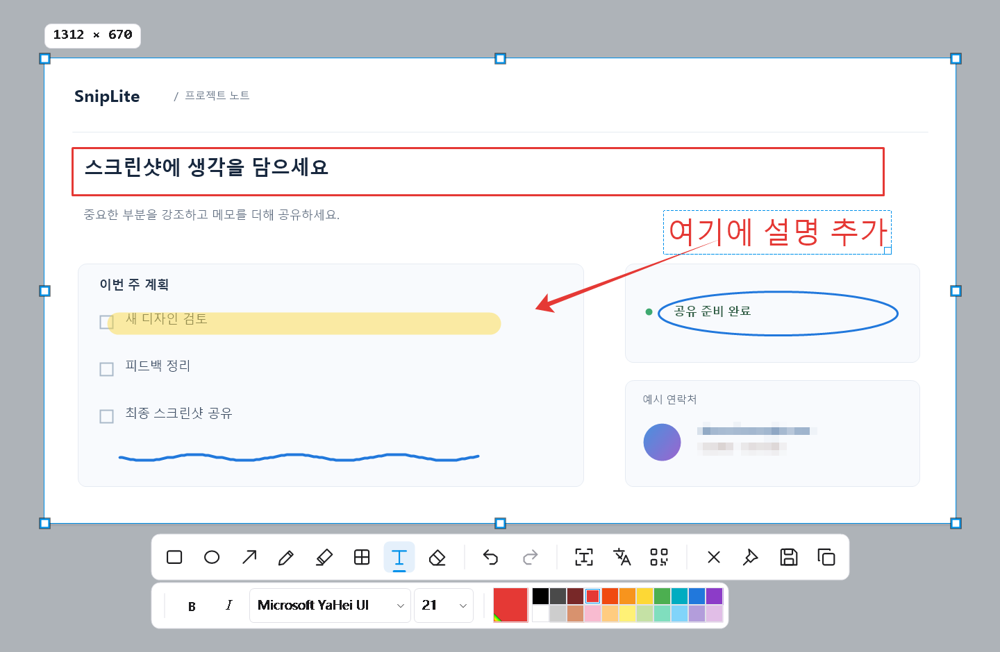
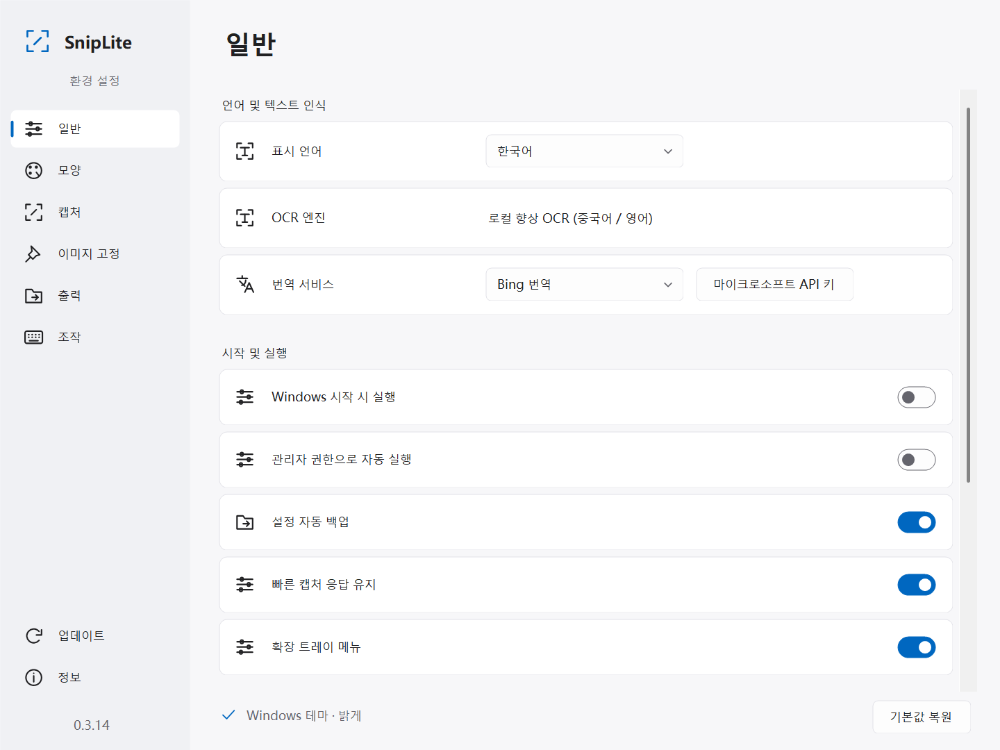

# SnipLite

<!-- languages:start -->
[English](../README.md) · [简体中文](README.zh-CN.md) · [繁體中文](README.zh-TW.md) · [日本語](README.ja.md) · **한국어** · [Français](README.fr.md) · [Deutsch](README.de.md) · [Español](README.es.md)
<!-- languages:end -->

**화면 캡처, 주석, 이미지 고정, OCR, 번역, QR 코드 인식을 하나의 Windows 도구에서 사용하세요.**

SnipLite는 Windows용 화면 캡처 및 이미지 고정 도구입니다. Snipaste에서 영감을 받은 조작 방식으로 화면 영역을 선택하고, 주석을 추가하고, 복사하거나 다른 창 위에 고정할 수 있습니다.

[소스 코드](https://github.com/GxDongV/SnipLite) · [다운로드](https://github.com/GxDongV/SnipLite/releases) · [문제 보고](https://github.com/GxDongV/SnipLite/issues)

## 미리 보기

### 캡처 및 주석

현재 앱의 도구 모음과 그리기 도구로 만든 주석 예시입니다. 사각형, 타원, 화살표, 펜, 형광펜, 편집 가능한 텍스트와 픽셀 모자이크를 보여 줍니다.

### 환경 설정

현재 앱의 한국어 환경 설정 화면입니다(밝은 모드).

## 주요 기능

- 창과 접근성 UI 요소를 자동 감지합니다. 클릭 또는 드래그로 캡처 영역을 선택합니다.
- 사각형, 타원, 화살표, 펜, 형광펜, 픽셀 모자이크, 지우개를 제공합니다. 텍스트를 다시 편집하고 이동하거나 크기를 조절할 수 있습니다.
- SimdPaddleOCR + PP-OCRv6 Small을 이용한 로컬 OCR. 일상적인 중국어·영어 인식에 적합합니다.
- 이미지 위에서 인식한 텍스트를 선택하고 복사합니다. QR 코드와 바코드 결과는 도구 모음 아래에 표시됩니다.
- 원문 위치에 번역문을 덮어 표시합니다. 서비스, 언어, 원문·번역문 보기를 전환할 수 있습니다.
- 이미지 고정, 확대·축소, 투명도, 썸네일, 그룹, 숨기기·복원, 마우스 클릭 통과를 지원합니다.
- 픽셀 돋보기, 전체 화면 십자선, RGB / HEX 색상 복사, Windows 밝은·어두운 테마를 지원합니다.

## 다운로드

[Releases](https://github.com/GxDongV/SnipLite/releases)에서 Windows x64 패키지를 선택하세요.

| 파일 | 사용 방법 |
| --- | --- |
| `single.exe` | 실행 파일을 바로 실행 |
| `setup.exe` | 설치 마법사로 설치 |
| `portable.zip` | 전체 압축을 풀고 `SnipLite.exe` 실행 |

세 패키지 모두 .NET 런타임을 포함합니다. 실행 후 시스템 트레이에 표시되며, 오른쪽 클릭으로 환경 설정이나 종료를 선택할 수 있습니다. 대상 시스템은 Windows 10 2004 / 빌드 19041 이상입니다. 런타임과 시스템 구성 요소의 요구 사항도 적용됩니다.

## 기본 조작

| 키 | 동작 |
| --- | --- |
| `F1` | 화면 캡처 시작 |
| `F3` | 현재 선택 영역 고정. 선택 영역이 없으면 클립보드에서 고정하거나 이전 이미지 복원 |
| `Ctrl+Alt+O` / `Ctrl+Alt+Q` | 영역 선택 후 OCR / QR 인식 |
| `Alt` / `C` | 돋보기 / 포인터 위치의 색상 복사 |
| `Enter` / `Ctrl+C` | 확인 / 복사 |
| `Ctrl+S` / `Ctrl+T` | 다른 이름으로 저장 / 고정 |
| 오른쪽 클릭 / `Esc` | 취소 또는 인식 모드 종료 |

## OCR, 번역과 이미지 고정

영역을 선택하고 **OCR**을 누른 다음 이미지 위에서 텍스트를 드래그하여 선택하세요. `Ctrl+A`는 전체 선택, `Ctrl+C`는 복사, `Esc`는 주석 편집으로 돌아갑니다. QR 인식 결과는 아래 행에 표시되며 오른쪽 버튼으로 복사할 수 있습니다.

번역 버튼을 누르면 원문 위에 번역문이 표시됩니다. 아래 행에서 서비스와 언어를 선택하고 원문·번역문 보기를 전환할 수 있습니다. 이미지 복사, 저장, 고정에는 현재 표시된 화면이 반영됩니다.

`F3`으로 선택 영역을 고정하세요. 고정 이미지는 드래그로 이동하고, 휠로 확대·축소하고, `Ctrl` + 휠로 투명도를 조절합니다. `Ctrl+0`은 원래 크기로 복원합니다. 오른쪽 클릭 메뉴에서 그룹, 썸네일, 클릭 통과를 설정할 수 있습니다.

## 표시 언어

처음 실행하면 Windows 표시 언어를 따릅니다. 환경 설정의 «일반 → 표시 언어»에서 자동 또는 8개 언어 중 하나를 선택할 수 있습니다. 변경은 즉시 적용되며 편집 중인 이미지와 인식 결과는 유지됩니다. 지원하지 않는 언어는 영어로 표시하고, 기존에 저장한 언어 설정도 유지합니다.

인터페이스 언어, OCR 인식 언어, 번역 언어는 서로 독립적입니다. 한국어 인터페이스를 선택해도 향상된 OCR 모델의 인식 언어가 추가되지는 않습니다. 언어 리소스는 앱에 포함되어 오프라인으로 작동합니다.

## 번역과 데이터

OCR, QR 인식, 이미지 처리는 기기에서 수행됩니다. 번역할 때 추출한 텍스트만 선택한 서비스에 전송하며 이미지는 업로드하지 않습니다. 기본 서비스는 Bing이고 기본 방향은 영어 → 중국어 간체입니다. Google, MyMemory, Microsoft Azure로 전환할 수 있습니다. Azure에는 본인의 API 키가 필요하며 다른 서비스에도 사용량 제한이나 변경이 있을 수 있습니다.

설정은 `%APPDATA%\SnipLite\settings.json`에 저장됩니다. 캡처 및 고정 이미지 기록은 현재 세션에만 유지됩니다.

## 피드백과 라이선스

문제나 제안은 [GitHub Issues](https://github.com/GxDongV/SnipLite/issues)에 알려 주세요. 앱 버전, Windows 버전, 화면 배율과 재현 단계를 포함해 주세요.

[MIT](../LICENSE) · [타사 라이선스](../THIRD_PARTY_NOTICES.md)

OCR에는 SimdPaddleOCR / PP-OCRv6 Small을, 코드 인식에는 ZXing.Net을 사용합니다. SnipLite는 Snipaste와 제휴 관계가 없습니다.
