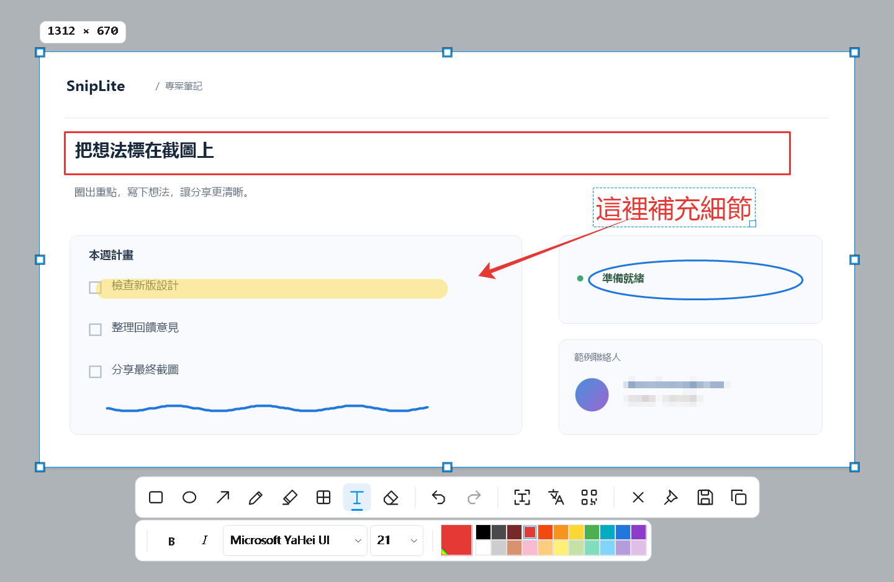
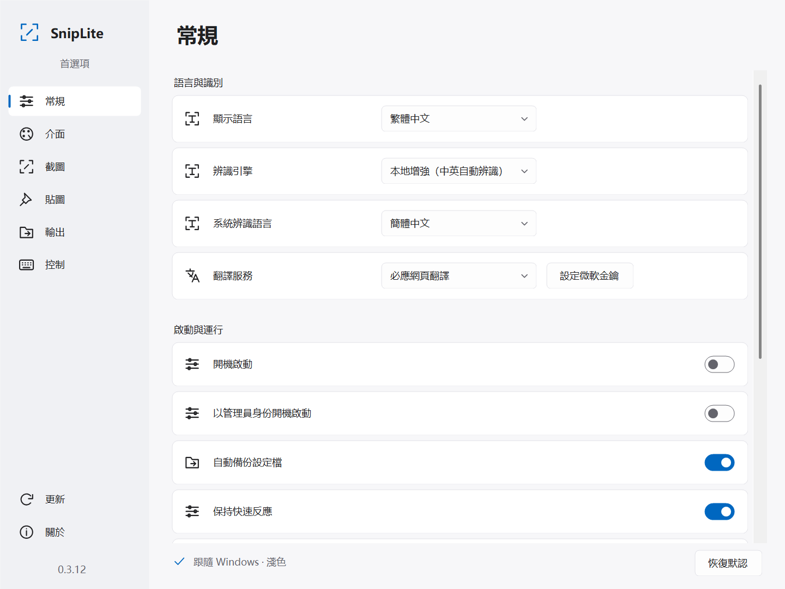

# SnipLite

<!-- languages:start -->
[English](../README.md) · [简体中文](README.zh-CN.md) · **繁體中文** · [日本語](README.ja.md) · [한국어](README.ko.md) · [Français](README.fr.md) · [Deutsch](README.de.md) · [Español](README.es.md)
<!-- languages:end -->

**截圖、標注、貼圖、提取文字、翻譯與識別二維碼，在一個托盤小工具裡完成。**

SnipLite 是一款 Windows 截圖與貼圖工具，操作靈感來自 Snipaste。按下快捷鍵，框選屏幕、添加標注，將圖片複製或貼在桌面上；也可以直接從截圖中選取文字、讀取二維碼內容。

Windows · 原生桌面界面 · 本地識別 · MIT

[源代碼](https://github.com/GxDongV/SnipLite) · [問題反饋](https://github.com/GxDongV/SnipLite/issues) · [發布版本](https://github.com/GxDongV/SnipLite/releases)

## 界面預覽

### 擷取與塗鴉標註

使用目前程式的工具列與繪圖工具展示標註效果：矩形、橢圓、箭頭、畫筆、螢光筆、可編輯文字與像素馬賽克。

### 首選項

目前程式的繁體中文首選項介面（淺色模式）。

## 亮點

- **截圖後直接識別文字**：工具欄內置 OCR，在原圖上拖動選字，支持全選、複製，按 Esc 返回標注。中英文日常辨識在本機完成，無需 API Key；也可在首選項中切換 Windows 系統辨識。
- **二維碼結果就地顯示**：二維碼及常見條碼識別結果顯示在工具欄下方，點擊右側按鈕複製完整內容，長結果支持省略與懸停查看。
- **譯文直接覆蓋原文**：點擊工具欄「譯」，預設英語轉中文，譯文按文字塊覆蓋到截圖原位置；完整工具欄保持可用，下方一行選擇語言、查看翻譯狀態，通過獨立圖標切換原文與譯文。
- **文字標注可以反覆修改**：已有文字可再次點擊編輯，定位插入、拖動選字、替換內容，支持字體、字號、粗體與斜體。工字形光標隨字號調整，文字框可移動和縮放。
- **常用標注工具齊全**：矩形、橢圓、多種箭頭、畫筆、半透明馬克筆、像素馬賽克與橡皮擦，支持調色、大小調整及撤銷、重做。
- **把參考圖貼在桌面上**：圖片置頂顯示，拖動移動、滾輪縮放、調整透明度；支持隱藏與恢復貼圖、貼圖分組、縮略圖和滑鼠穿透，也可將剪貼板文字轉成圖片。
- **精細選區與取色**：窗口及可訪問控件自動框選、全屏輔助十字線、像素放大鏡、RGB / HEX 取色，拖動滑鼠可隨時自定義截圖範圍。
- **八語言介面**：預設跟隨 Windows 顯示語言，可手動切換英語、簡繁中文、日語、韓語、法語、德語和西班牙語，切換後即時生效。
- **本地識別，可選在線翻譯**：OCR、條碼解碼與圖片處理均在本機完成；點擊翻譯時僅將提取的文字發送給所選翻譯服務，不上傳截圖。

## 下載與啟動

在 [Releases](https://github.com/GxDongV/SnipLite/releases) 選擇 Windows x64 版本：

| 版本 | 使用方式 |
| --- | --- |
| `single.exe` 單文件版 | 下載一個 EXE 後直接運行 |
| `setup.exe` 安裝版 | 通過向導安裝，提供開始菜單快捷方式和卸載入口 |
| `portable.zip` 解壓版 | 完整解壓後運行 `SnipLite.exe` |

這三種發布包均包含 .NET 運行時，無需另外安裝 .NET。單文件版首次啟動會釋放原生依賴。MIT 與第三方許可證可在「幫助 → 開源許可證」中離線查看。

當前目標系統最低為 Windows 10 2004（Build 19041）。實際可用性還取決於所用 .NET 運行時與系統組件。增強 OCR 模型隨程序附帶，首次使用時加載，無需聯網下載；切換或回退到 Windows OCR 時需要系統安裝相應的識別語言包。

## 常用操作

以下為預設綁定，可在「首選項 → 控制」修改全局快捷鍵。

| 操作 | 功能 |
| --- | --- |
| `F1` | 開始截圖 |
| `F3` | 已有截圖選區時直接貼出當前選區；平時貼出剪貼板圖片或恢復貼圖 |
| `Ctrl+Alt+O` | 框選後識別文字並複製 |
| `Ctrl+Alt+Q` | 框選識別二維碼 / 條碼，顯示可複製結果 |
| 單擊高亮區域 / 拖動滑鼠 | 自動選區 / 自定義選區 |
| 滑鼠右鍵 | 取消當前截圖 |
| `Alt` / `C` | 顯示放大鏡 / 複製指針處顏色 |
| `Enter` / `Ctrl+C` | 確認當前截圖 / 複製截圖 |
| `Ctrl+S` / `Ctrl+T` | 另存為 / 將選區貼到桌面 |
| `Ctrl+Z` / `Ctrl+Y` | 撤銷 / 重做標注 |

### 標注與識別

選區後通過工具欄使用矩形、橢圓、箭頭、畫筆、馬克筆、文字、馬賽克和橡皮擦。

文字工具下，單擊已有文字即可繼續編輯；按 Enter 提交，Shift+Enter 換行，Esc 取消本輪修改。拖動文字框邊緣移動文字，右下角手柄用於縮放。

點擊 **OCR** 後按鈕保持選中，上方完整工具欄保留，下方另加狀態行顯示識別進度和劃詞提示。拖動選字、Ctrl+A 全選、Ctrl+C 複製；狀態行「複製文字」複製選中文字，未選字時複製全部結果。再次點擊 OCR 或按 Esc 返回編輯，點擊其他標注工具可直接退出劃詞並切換工具。上方複製、保存和貼圖按鈕繼續按截圖功能執行。點擊 **QR** 查看單行結果，點擊「複製」複製完整內容，Esc 收起結果。識別模式中的快捷鍵優先作用於文字或識別結果。

在「首選項 → 常規 → 識別引擎」可切換增強識別與 Windows OCR。「系統識別語言」只作用於 Windows 引擎。增強引擎發生異常時自動嘗試系統引擎；兩種方式均在本機處理圖片。OCR 劃詞允許在字符框邊緣附近按下滑鼠，拖動時吸附最近文字。

點擊 **譯** 後按鈕保持選中，自動識別截圖並將譯文覆蓋在原文位置，完整標注工具欄繼續保留。下方只增加一行語言與翻譯狀態欄：首次預設英語 → 中文簡體，之後記住語言選擇；源語言可設為「自動檢測語言」，雙向箭頭交換語言方向，眼睛圖標切換原文/譯文。改變語言復用識別結果，調整選區後重新識別翻譯。

上方的複製截圖、保存與貼圖輸出當前顯示的畫面，新標注顯示在譯文上方；下方複製圖標複製當前原文或譯文的文字。再次點擊「譯」或按 Esc 關閉翻譯並恢復原圖。網路錯誤或請求受限在狀態欄提示，懸停可查看完整說明，點擊重試圖標重新翻譯。

原位覆蓋按照文字區域周圍的背景顏色填充，再將譯文縮放排入原區域，適合常見淺色/深色界面和純色文字背景；復雜圖片背景、旋轉文字及特別密集的排版可能無法無痕還原背景。原圖始終保留，切換顯示不會修改源像素。

「首選項 → 常規 → 翻譯服務」預設使用必應網頁翻譯，也可選擇 Google、MyMemory 或 Microsoft Azure。必應和 Google 使用各自的網頁接口，無需用戶配置密鑰，網頁接口可能限流或變更。選擇 Microsoft Azure 時，先填寫 Azure Translator 資源的密鑰和區域（全局 Translator 資源的區域可留空）。密鑰由 Windows 按當前用戶加密保存在本機。[微軟接入文檔](https://learn.microsoft.com/en-us/azure/cognitive-services/translator/quickstart-translator)

MyMemory 無需注冊或配置密鑰，使用時在翻譯欄手動選擇源語言。匿名額度為每天 5,000 字符，程序按單次最多 500 個 UTF-8 字節分段，並在額度用盡時提示。[額度說明](https://mymemory.translated.net/doc/usagelimits.php) · [API 文檔](https://mymemory.translated.net/doc/spec.php)

首選項設置預設翻譯服務。截圖後也可以點擊翻譯欄上的服務名稱切換本次截圖的服務，程序用已識別的文字重新翻譯。

翻譯需要聯網，截圖中識別出的文字發送給所選服務。普通 OCR 在本機運行。

### 貼圖

截圖選區確定後按 F3，直接將當前選區（包含標注及當前顯示的譯文）貼到桌面。未打開截圖時，F3 可恢復隱藏貼圖或貼出新複製的內容。截圖、剪貼板圖片和文字生成的貼圖都進入同一份貼圖歷史。關閉貼圖後，繼續按 F3 會按創建時間從新到舊逐張恢復。

滾輪縮放時，貼圖左上角會短暫顯示相對於原圖的比例。普通貼圖縮放範圍為 10%–500%，同時受首選項中的最大窗口尺寸限制。

拖動貼圖移動位置，滾輪縮放，Ctrl+滾輪調整透明度，Ctrl+0 恢復原始大小。右鍵菜單提供複製、保存、識別及貼圖管理功能。

## 界面語言

首次啟動預設跟隨 Windows 顯示語言。可在「首選項 → 常規 → 顯示語言」選擇跟隨系統、English、簡體中文、繁體中文、日本語、한국어、Français、Deutsch 或 Español，切換後即時生效。未支持的系統語言使用英文，舊版保存的語言選擇保持不變。界面語言與 OCR 識別語言、翻譯方向相互獨立；增強 OCR 仍以中英文日常識別為主。

所有界面語言資源隨程序離線附帶，不需要下載語言包或調用翻譯服務。

## 首選項與數據

界面采用 Windows 11 風格的側邊導航、圓角設置卡片和矢量線條圖標，自動跟隨 Windows 的淺色 / 深色模式，運行中切換無需重啟。預設托盤圖標單獨跟隨任務欄的明暗設置；也可繼續選擇彩色或自定義圖標。

首選項支持主題色、界面字體、放大鏡、自動選區、截圖動作、貼圖行為、保存路徑、文件名模板、快捷鍵與沖突提示等設置，修改後即時保存。

托盤右鍵 →「幫助」可查看項目來源，並直接點擊 GitHub 倉庫地址或問題反饋鏈接；「更新」頁提供發布版本入口。

| 數據 | 預設位置 / 行為 |
| --- | --- |
| 設置 | `%APPDATA%\SnipLite\settings.json`，可在首選項中遷移 |
| 應用日志 | `%LOCALAPPDATA%\SnipLite\app.log`，日志級別可配置 |
| 異常日志 | `%TEMP%\SnipLite\error.log` |
| 截圖文件 | 預設通過複製或手動保存輸出，自動保存可在首選項中開啟 |
| 截圖及貼圖歷史 | 當前運行會話內保留，退出後不恢復 |

## 問題回報

歡迎透過 [GitHub Issues](https://github.com/GxDongV/SnipLite/issues) 回報問題或提出功能建議。反饋時請提供程序版本、Windows 版本、屏幕縮放比例、復現步驟和相關日志；截圖可僅保留與問題有關的區域。

## 許可證與致謝

項目源碼采用 [MIT License](../LICENSE)。二維碼與條碼解碼使用 [ZXing.Net](https://github.com/micjahn/ZXing.Net)，相關依賴聲明見 [THIRD_PARTY_NOTICES.md](../THIRD_PARTY_NOTICES.md)。增強 OCR 使用 [SimdPaddleOCR](https://github.com/sdcb/SimdPaddleOCR) 與 PP-OCRv6 Small；同時提供 Windows OCR 系統引擎。

SnipLite 與 Snipaste 沒有隸屬關系；Snipaste 名稱及其相關權利歸原權利人所有。
