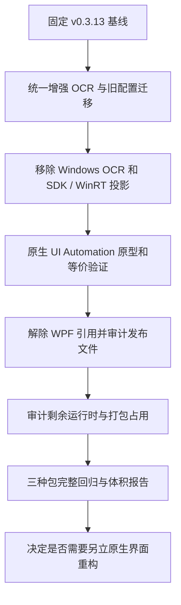

# SnipLite 体积优化实施方案

状态：方案阶段，尚未修改功能代码。本文描述准备实施的设计，验收数值是拟定标准，不能视为已经完成的结果。

| 项目 | 内容 |
| --- | --- |
| 更新日期 | 2026-11-16 |
| 工作分支 | `codex/package-size-optimization` |
| 对照版本 | `v0.3.13` |
| 起点提交 | `a2c8e53a55c13231863e33190ffbb89ca1471bc1` |
| 核心选择 | 保留 SimdPaddleOCR + PP-OCRv6 Small，移除 Windows OCR |
| 发布方式 | 继续提供自包含的单文件版、安装版和解压版 |

## 1. 目标与取舍

### 1.1 必须保留

- 保留当前增强 OCR 的引擎、模型、文字方向判断、字符位置与划词复制能力，不更换较弱模型换取体积。
- 截图、标注、文字再次编辑、贴图、二维码与条码、截图翻译、全局热键、八语言和浅深色主题继续可用。
- 保持当前界面风格、控件尺寸和交互逻辑。允许替换内部依赖，不以功能退化换体积。
- 无需用户安装开发工具或 .NET，OCR 模型随包提供；首次 OCR 不联网下载。
- 继续以 Windows x64 为本轮目标，保持项目现有最低系统版本约束，不在瘦身时顺便升级依赖和最低系统要求。

### 1.2 明确移除

移除 Windows OCR 引擎选择、系统 OCR 语言设置、启动预热及增强 OCR 失败时的系统回退。当前增强模型主要面向日常中英文；系统 OCR 语言包所支持的额外识别语言不再提供。界面八语言与 OCR 识别语言相互独立，帮助文案需要明确这一点。

Windows SDK / WinRT 是调用系统 API 的桥梁，不是第二份 Paddle 模型。当前代码对这组接口的使用集中在 Windows OCR 及其图像处理流程；删除该流程后，再从项目引用与发布结果确认依赖是否完全退出。

### 1.3 本轮不作为默认路径

不以依赖用户安装运行时的轻量版代替实际优化；不直接重写整个界面；不通过强制裁剪、删除未知 DLL、降低模型精度或改成在线 OCR 达成体积目标。保留后续原生界面重构的评估入口。

## 2. 现状与测量基线

### 2.1 发布包体积

以下来自 v0.3.13 实际本地产物，单位 MiB（1 MiB = 1,048,576 字节）。ZIP 列为文件的压缩载荷，不含 ZIP 目录等少量开销。

| 组件 | 解压后 | ZIP 压缩载荷 | 本轮处理 |
| --- | ---: | ---: | --- |
| Windows 桌面框架 | 77.33 | 31.44 | 保留 WinForms，消除 WPF 专用依赖 |
| .NET 基础运行时 | 76.58 | 35.11 | 保留，审计有证据可排除的附属组件 |
| OCR 模型 | 30.68 | 25.76 | 完整保留 |
| Windows SDK / WinRT | 24.23 | 6.32 | 移除系统 OCR 后争取全部退出 |
| OCR 引擎 | 2.12 | 0.67 | 保留 |
| 文档与许可证 | 1.24 | 0.90 | 保留多语言说明与预览 |
| 主程序及配置 | 0.95 | 0.37 | 依设计调整 |
| 二维码与条码库 | 0.52 | 0.24 | 保留 |
| 合计 | 213.66 | 100.80 | 以新发布结果复测 |

| 下载文件 | 基线大小 |
| --- | ---: |
| 单文件 EXE | 103.99 MiB |
| 安装 EXE | 79.54 MiB |
| 解压 ZIP | 100.84 MiB |

77.33 MiB 桌面框架中包含必需的 WinForms，不能全部算作可删除空间。24.23 MiB SDK / WinRT 是当前这组文件的体积，也不是任何一种压缩包必然减少的数值。

### 2.2 代码使用事实

| 位置 | 当前行为 | 优化影响 |
| --- | --- | --- |
| `src/SnipLite/Services.cs` | 选择增强 OCR 或 Windows OCR，增强异常时回退 | 统一识别入口与错误处理 |
| `src/SnipLite/SimdOcr.cs` | 延迟加载增强模型，串行化推理，输出字符坐标 | 保留核心识别流程 |
| `src/SnipLite/CaptureForm.cs` | 截图划词识别、悬停自动选区 | 改 OCR 调用与 UIA 后端 |
| `src/SnipLite/CaptureTranslation.cs` | OCR 后按文字块翻译 | 使用同一个增强 OCR 入口 |
| `src/SnipLite/PinForm.cs` | 贴图文字识别并复制 | 改入口并区分空结果与识别失败 |
| `src/SnipLite/TrayContext.cs` | 启动时按设置预热 Windows OCR | 删除无效预热 |
| `src/SnipLite/PreferencesPages.cs` | 显示引擎和系统语言选择 | 收敛为本地中英自动识别说明 |
| `src/SnipLite/DesktopTargets.cs` | Win32 + MSAA + 托管 UI Automation | 保留前两者，替换托管 UIA |
| `src/SnipLite/SnipLite.csproj` | 同时启用 WinForms、WPF 和 Windows SDK 投影 | 分阶段调整引用与发布 |

### 2.3 衡量方法

为每个阶段保存：源码提交、SDK/运行时/依赖版本、构建命令、每个文件的大小及 SHA256、依赖归属、三种包大小、启动耗时、首次及再次 OCR 耗时。固定同一台机器、同一组输入和同一套发布参数比较。

分别统计下载大小、便携目录大小、安装后程序目录大小、单文件缓存释放占用和运行时内存。压缩包变小不自动代表安装占用或内存变小。

## 3. 总体技术路线

每一步只解决一类依赖问题，完成构建和针对性验证后单独提交。出现回归先停在当前阶段，不叠加更多优化掩盖问题。

## 4. 阶段 A：建立可重复基线

### 实施

1. 保留 v0.3.13 对照产物和校验值，不运行会删除整个 `artifacts/` 的全量清理脚本。
2. 为实验使用独立输出目录，例如 `.local/package-size-optimization/<阶段>/`，不覆盖正式发布目录和用户正在运行的程序。
3. 导出 `.deps.json` 和完整文件清单，记录直接引用、隐式 SDK 引用、托管与原生运行时文件。
4. 固定标注演示画布、OCR 样例和自动框选测试应用。界面图片用真实控件与真实渲染生成。
5. 对旧版和优化版使用隔离的测试配置、模型缓存和单文件释放目录；暂不改生产配置路径，必要隔离能力只放在本地验证辅助程序中。

### 完成条件

基线可按同一脚本重建；能够对比三种包和逐文件变化；确认视频、测试输入、日志与编译中间文件不会进入源码提交或分发包。

## 5. 阶段 B：统一增强 OCR

### 5.1 识别接口

目标接口收敛为 `RecognizeTextAsync(Bitmap, CancellationToken)`，返回现有 `OcrDocument`。无须引入多引擎插件框架，也不额外更换识别库。

- `SimdOcr` 保留延迟初始化、并发限制、图像大小限制和原坐标映射。
- 截图、贴图、翻译、OCR 快捷键全部使用同一个识别入口。
- 扩展取消参数时至少取消排队和等待结果的应用；如果底层同步推理不能中断，允许其完成，但不再应用过期结果。
- 推理仍使用时不能提前释放输入图像或共享引擎；延续识别请求版本号和翻译请求版本号的有效性判断。

### 5.2 错误与重试

区分三种状态：成功且有文字、成功但没有文字、执行失败。取消属于独立操作状态，不显示失败提示。

- 移除 `Services.OcrAsync` 将所有异常转换为空字符串的做法，调用端负责展示简洁提示，日志保留详细异常。
- 模型缺失、损坏、加载失败或推理异常，状态行提示识别失败并提供现有操作可触发的重试；错误详情通过轻量入口复制，不增加大弹窗。
- 贴图 OCR 失败不再提示“没有识别到文字”，不覆盖剪贴板原内容，不影响该贴图继续操作。
- 翻译在 OCR 失败时不发送请求；OCR 成功后继续保留原有服务选择、源目标语言、缓存和取消机制。
- 初始化失败不缓存一个永久失败状态；重复尝试要受并发门控制。若证明共享引擎需要重建，只能在没有正在使用它的推理任务时释放并重建。
- 本轮不新增启动时增强模型预热。删除系统预热后保留“保持快速响应”设置对其他行为的原有作用。

### 5.3 首选项与旧配置

优先保留 `OcrEngine`、`OcrLanguage` 为内部兼容字段一个迁移周期，避免旧配置反序列化失败及降级时丢失信息；停止在生产识别路径读取它们。不再让运行代码依赖已移除的 Windows 引擎枚举。

如旧字段存在枚举约束，需要保留兼容定义或在读取阶段转换，不能先删除枚举成员再让旧值触发归一化异常。兼容字段不重新出现在首选项和用户操作中。

| 旧配置情况 | 升级后行为 |
| --- | --- |
| 默认或增强 OCR | 继续使用同一增强模型 |
| 选择 Windows OCR | 使用增强 OCR，其他配置保留 |
| 缺少 OCR 字段 | 使用增强 OCR，不执行配置重置 |
| OCR 字段值异常 | 按现有设置容错策略处理，避免影响语言、热键和保存目录 |
| 回退到 v0.3.13 | 通过升级前配置备份恢复；不能只依赖可能被后续保存覆盖的单份 `.bak` |

实现前确认 `JsonOptions` 对枚举的实际序列化方式，并覆盖现有数字/字符串中真正支持的格式；不凭假设新增不兼容的配置格式。迁移时不覆盖翻译密钥或改变其加密方式。

首选项删除引擎选择与系统识别语言两行，用简短静态说明展示“本地识别，中英文自动识别”。保留软件已有间距、字体、卡片样式。八语言资源、帮助、开发说明和 README 同步更新；移除旧文案前检查所有调用与资源占位符。

### 5.4 完成条件

所有生产 OCR 路径只调用增强 OCR；模型与方向模块完整保留；旧配置迁移通过；空结果、失败和取消不会互相混淆；翻译与划词坐标不变。

## 6. 阶段 C：移除 Windows SDK / WinRT 专用依赖

### 实施

1. 删除 `RecognizeWindowsTextAsync`、`Windows.Media.Ocr`、`Windows.Graphics.Imaging`、`Windows.Globalization` 以及 `AsRandomAccessStream` 等相关调用。
2. 全仓检查生产源码、资源构建、项目与传递依赖，确认其他功能不再使用 WinRT 类型。Windows 显示语言查询使用现有 Win32 P/Invoke，不应误删八语言系统匹配。
3. 先在隔离构建中研究 Windows 目标框架自动引入 SDK 投影的机制。评估保持当前 TFM 并使用受支持的投影开关，或改成不引入投影的 Windows TFM；不能仅删除 `using` 后宣布依赖已移除。
4. 如果改变目标框架，同时校准 `SupportedOSPlatformVersion`、平台分析标记和安装器限制；不能让声明的最低平台高于 TFM 可接受的平台版本，不能为消除警告而全局关闭平台分析。实际最低 Windows 版本继续保留在程序/安装器约束和文档中。
5. 重新还原和发布，检查 `project.assets.json`、`.deps.json`、程序集引用、单文件内容与最终目录。

### 预期收益与完成条件

候选移除文件是 `Microsoft.Windows.SDK.NET.dll`（23.73 MiB）和 `WinRT.Runtime.dll`（0.50 MiB）。合计解压约 24.23 MiB，原 ZIP 载荷约 6.32 MiB；压缩 EXE 的收益另测。

最终分发不包含这组文件，也不保留依赖它们的调用。最低 Windows 环境启动、截图、增强 OCR 和翻译通过。若仍有必要引用，记录引用来源后修订方案，不使用强制发布排除掩盖缺失依赖。

## 7. 阶段 D：原生自动框选替换托管 UIA

### 7.1 架构与边界

在现有 `DesktopTargets` 与 `CaptureForm` 的交互边界内新增一个小型原生后端，例如 `NativeUiAutomation`，只负责返回候选矩形。Win32 顶层窗口快照、子窗口检测和 MSAA 路径保留。

选用 Windows 自带 UI Automation COM API。接口声明来自 Windows SDK 类型库或可信的生成过程，核对 IID、继承顺序、vtable、结构体尺寸、HRESULT 和参数封送；不手写省略前序方法的残缺 COM 接口，不引入一个同样庞大的通用 UI 库。

后端至少涵盖：从 HWND 获取元素、遍历子元素/兄弟、获取矩形和离屏状态。可缓存本次遍历所需属性减少跨进程访问；缓存的生命周期限于请求，不保留已经失效的外部 UI 对象。

### 7.2 遮罩下命中规则

1. 利用截图开始前的窗口 Z 顺序及指针坐标确定底层应用 HWND。
2. 在该应用及已检测出的子窗口树内查找。不能直接全桌面 `ElementFromPoint` 命中截图遮罩，也不能为了查找先隐藏遮罩造成闪烁。
3. 保留对根窗口和内容子 HWND 的互补查询。无自身矩形的虚拟节点允许向下遍历，不把整个内容面板漏掉。
4. 候选必须包含当前物理坐标点，与目标窗口相交后有有效面积，优先选择满足规则的较小矩形。
5. 支持负屏幕坐标和混合 DPI；不重复缩放已经是物理像素的坐标。排除已知遮罩、透明辅助窗口及被遮挡的非目标窗口。

### 7.3 线程、超时与生命周期

- UIA 查询在独立、无窗口的 MTA 工作线程执行，COM 对象在拥有它们的线程上创建、使用和释放，不把 RCW 直接交回 UI 线程。
- 使用有界队列，只保留当前需要的坐标；最多两个查询槽位。UI 线程只接收值类型矩形和请求标识，不等待跨进程 COM 调用。
- 优先使用可用的 `IUIAutomation2` 连接及事务超时。工作线程间保持同一请求的对象归属；COM 初始化与反初始化配对。
- 遍历先沿用现有最多 800 节点、深度 30 的上限，增加总耗时预算并通过实测调参。节点上限和 Task 超时不能中断已经阻塞的 COM 调用，不能宣称它们提供硬超时。
- 慢提供者占用槽位时跳过新的 UIA 查询，Win32 与 MSAA 保持独立可用，不无限创建线程。持续阻塞属于必须分析的问题；若系统级超时仍不足以满足验收，再评估可重启辅助进程隔离，不默认引入该复杂度。
- 处理窗口关闭、权限不足、提供者失效和截图退出。对象按明确所有权释放，不对共享或仍被使用的 RCW 强制 `FinalReleaseComObject`。

### 7.4 UI 更新与交互

保留目前 120 ms UIA 查询节流及 750 ms 同点重试作为对照初值；MSAA 保持独立节流。每次截图与查询带请求代号。

仅在截图仍有效、尚未确定选区、没有拖拽、指针仍在原坐标且结果属于当前请求时应用。晚到的粗区域不能覆盖同一点已解析出的细区域。停留后继续重试以适配应用迟建的控件树。

左键单击使用已高亮区域，鼠标拖动进入自定义选区，右键/Esc 取消保持原行为。不能以只识别整个窗口作为控件检测完成的标准。

### 7.5 完成条件

真实 Win32、浏览器/Electron 和内容面板场景达到与旧版相当的命中表现；遮罩不闪、主线程不卡、旧结果不跳回。受系统权限或应用可访问性限制的场景明确记录；既有管理员启动模式不变，不自动提权。

## 8. 阶段 E：解除 WPF 并精简发布依赖

原生后端验收后，移除 `UseWPF` 与生产代码的 `System.Windows.Automation` 类型。检查其他隐式 WPF 引用，防止测试辅助项目重新拉回这些依赖。

重点审计 `PresentationFramework`、`PresentationCore`、WPF 图形原生库、XAML、Ribbon 和托管 UIAutomation 程序集。它们是检查候选，不是允许直接删除的名单；`WindowsBase` 等文件是否保留由真实 WinForms 依赖闭包决定。

必须区分“代码不再引用 WPF”和“SDK 不再发布 WPF 文件”。若 WindowsDesktop 运行时包仍带入额外组件，优先使用受支持的框架/发布配置；只有确认依赖闭包、动态加载和原生依赖后，才对可证明无用的文件建立版本限定的发布规则。

规则在生成目录、ZIP、安装器和单文件 bundle 之前执行，不能只删解压版文件，导致三个版本内容不一致。依赖版本改变后重新审计，未知文件默认保留并报告。

完成条件：生产代码与运行路径不再依赖 WPF；界面、框选回归通过；发布文件变化逐项可解释。如果某个文件因 WinForms 必需而保留，列出理由，不为追求“零 WPF 文件”破坏框架运行。

## 9. 界面外观与彻底原生化的取舍

当前 `FluentControls`、`AnnotationBar`、`SnipMenu`、主题、标注与阴影已经包含项目自绘实现。前几阶段复用它们，不重新设计一套不同风格。

界面保真覆盖颜色、字体、控件高度、圆角、间距、图标、悬停/选中/禁用状态、菜单边界、文字插入与输入法、滚动和多显示器定位。移除系统 OCR 的两行设置是预期差异，其他差异需要解释。

自行绘制相同外观可行，但保留 WinForms 宿主就仍需要 .NET。若前述优化后仍不满足体积需求，另开原型验证原生 Win32 窗口和自绘前端，同时解决输入法、剪贴板、拖放、DPI、无障碍、托盘及快捷键。

彻底去掉 .NET 还要验证 SimdPaddleOCR 的当前 .NET 入口是否有可独立部署的原生等价实现。只换窗口层、后台继续启动 .NET OCR 进程，未必减少总分发体积。未完成该验证前，不承诺几 MiB 包体或可无成本复用现有识别代码。

## 10. 阶段 F：剩余运行时与打包审计

| 候选措施 | 决策 |
| --- | --- |
| 设计器程序集 | 查明动态依赖；能证明无用才单独排除并回归字体、颜色、文件对话框等 |
| 诊断组件 | 查明加载和故障诊断影响，保留必要组件及可诊断能力 |
| 全量 `PublishTrimmed` | 本轮不启用，WinForms/WPF 的框架级裁剪存在官方限制 |
| Native AOT | 不作为当前项目直接发布开关；需要独立技术验证 |
| ReadyToRun | 维持基线配置，不为启动速度额外引入未经测量的体积增长 |
| 单文件压缩 | 保持现有压缩，测量启动与解压缓存代价 |
| 安装器压缩 | 保留 LZMA2，评估压缩参数时同时记录安装耗时和峰值占用 |
| 运行时依赖版 | 可后续补充，但不计入本轮自包含包的瘦身成果 |
| 远程下载 OCR 模型 | 本轮不采用，保持模型离线可用 |
| 删除语言/预览/许可证 | 不作为优化重点，不牺牲八语言使用说明和许可证 |

阶段结束输出实际收益。如果只剩运行当前 WinForms/.NET 所需的主要文件，接受这一体积下限，不用未经证实的删除策略凑目标。

## 11. 验证矩阵与验收标准

### 11.1 功能与兼容性

| 类别 | 必测场景 | 通过条件 |
| --- | --- | --- |
| OCR 内容 | 中英混排、小字号、浅深背景、方向文字、空白、大图 | 固定样例结果与保留的同版本增强引擎对照一致；空白无假失败 |
| OCR 交互 | 边缘选字、拖出范围、全选复制、退出重试、并发贴图 | 字符坐标及复制内容一致，UI 可操作，无剪贴板误覆盖 |
| OCR 故障 | 模型缺失/损坏、初始化异常、退出时请求完成 | 有失败提示，可再次尝试，不退出软件、不应用过期结果 |
| 翻译 | OCR 后切服务/语言、取消、原译文切换、保存贴图 | 继续共用增强 OCR，失败不发请求，导出内容与当前显示一致 |
| 自动框选 | Win32 子控件、浏览器页面、Electron 内容、停留重试 | 可选控件级区域；点击、拖动、取消与对照一致 |
| 提供者异常 | 目标程序关闭/无响应、权限边界 | 截图主线程继续响应，工作线程和查询数有界 |
| 标注 | 全部工具、极大画笔、小选区、文字重编、字体滚动、撤销 | 不重现原有崩溃或编辑问题，文字尺寸和坐标一致 |
| 贴图 | F3、历史恢复、缩放、透明度、阴影、分组 | 行为与 v0.3.13 对照一致 |
| QR / 条码 | 成功、空结果、长内容、复制 | 与 OCR 解耦，结果显示与复制正常 |
| 系统集成 | F1/F3、其他全局热键、托盘、自动启动、管理员模式 | 原有配置与注册方式保留，不因依赖替换失效 |
| 配置 | 全新/旧版增强/旧版 Windows OCR/异常 OCR 字段 | 按迁移表执行，其他配置与凭据不变 |
| 界面 | 八语言、浅深主题、高对比度、100/150/200% DPI | 无新增裁切、错位、不可读或主题不一致 |
| 多显示器 | 负坐标、混合 DPI、跨屏选区、菜单靠屏边 | 框选、文字、贴图和菜单定位正确 |

复用现有有意义的检查，更新依赖已移除 Windows OCR/WPF 的验证项目；不为增加计数编写镜像实现的断言。旧检查次数不作为新版通过的证据。

### 11.2 性能目标

同一机器与样例下启动冷/热各至少 5 次，首次/再次 OCR 各至少 10 次，报告中位数及范围。冷启动定义、模型是否已加载和单文件缓存是否存在必须标注。

拟定进入人工复核的阈值：启动或 OCR 中位耗时相对对照增加超过 10%，同时绝对增加超过 50 ms；稳定后的内存明显持续增长；新增主线程阻塞超过 100 ms。阈值用于发现回归，不因某一次系统抖动直接判定失败。

自动框选记录候选矩形与耗时，不记录外部应用中的文字。提供者故障测试观察有界并发、CPU 和线程数；快速移动指针、重复 F1/Esc 至少 100 次后检查是否存在持续增长的 COM/窗口/GDI 资源。

### 11.3 分发验收

- 在没有 SDK、没有预装现代 .NET Desktop Runtime 的隔离 Windows x64 环境检查三种包，验证 Windows 10 目标下限及 Windows 11；主机 SDK 环境测试不能替代该项。
- 安装和卸载测试使用隔离目录及干净环境，避免覆盖用户现有安装、快捷方式和贴图。
- 解压版完整解压运行；安装版验证注册、升级、卸载并保留用户数据；单文件版验证首次释放、再次启动、离线 OCR 和清理缓存后重启。
- 附件文件版本、标签提交、许可证、README 链接和 SHA256 一致。所有包不含本地样例、视频、验证日志和编译中间产物。
- 如果没有可用的干净 Windows 环境，报告“尚未完成”，不把静态依赖检查写成整体验收通过。

## 12. 风险、停止条件与回退

| 风险 | 应对 | 停止/回退条件 |
| --- | --- | --- |
| 删除弱引擎后故障失去回退 | 增强引擎错误可见、可重试，截图功能独立 | 错误被误报为空结果或导致软件退出 |
| SDK 隐式引用仍保留 | 检查 TFM、还原图及程序集引用 | 只能靠删除必要 DLL 才能启动瘦身 |
| COM 声明不正确 | SDK 定义生成并核对，先做独立原型 | 崩溃、内存破坏或难以解释的调用失败 |
| UIA 阻塞或泄漏 | 独立 MTA、有界队列、系统超时、明确释放 | 主线程卡死、资源持续增加或无法恢复查询 |
| 框选能力降低 | 同点对照、真实软件验证、记录缺失场景 | 既有控件级选择退化为整窗 |
| WPF 文件被隐式发布 | 检查框架引用和实际发布闭包 | 需要靠不受控的大范围文件删除 |
| 外观与输入法退化 | 复用现有控件，图像与交互双重验证 | 字体/文字编辑、语言或 DPI 回归 |
| 运行时过度精简 | 单文件规则与依赖版本绑定、逐项回归 | 特定功能启动才缺程序集或原生库 |

阶段采用可独立撤销的提交。回退某项功能时同时恢复相关引用、文案和打包规则，不能留下“旧代码 + 新精简规则”的组合。

实验程序不自动覆盖用户配置。需要实际迁移验证前先保存独立配置快照；应用回退与配置回退分别验证。未通过整体验收不合并主分支，不复用正式版本标签，不自动发布实验构建。

## 13. 提交顺序与交付物

| 顺序 | 工作包 | 必须交付 |
| --- | --- | --- |
| 0 | 基线和审计 | 文件清单、依赖归属、环境与功能基线 |
| 1 | OCR 统一 | 单入口、错误/取消策略、旧配置兼容、针对性回归 |
| 2 | 移除 SDK / WinRT | 构建引用调整、依赖差异、系统兼容报告 |
| 3 | 原生 UIA 原型 | 可信 COM 声明、线程与超时设计、遮罩下框选对照 |
| 4 | 切换原生 UIA | 集成、过期结果控制、真实应用和故障测试 |
| 5 | 解除 WPF | 引用变更、界面保真、各发布形式依赖核验 |
| 6 | 剩余依赖精简 | 每项文件去留理由、实际收益和回归证据 |
| 7 | 整体交付 | 三种本地候选包、校验清单、前后体积/性能报告、已知限制 |

先完成前两项依赖移除的确定性收益，再决定后续原生化投入。每阶段结束填写下表，不用理论差额替代测量：

| 指标 | v0.3.13 | OCR/SDK 阶段 | UIA/WPF 阶段 | 最终候选 |
| --- | ---: | --- | --- | --- |
| 单文件下载 MiB | 103.99 | 97.97 | 78.75 | 78.75 |
| 安装版下载 MiB | 79.54 | 76.06 | 61.61 | 61.61 |
| 解压版下载 MiB | 100.84 | 94.52 | 74.55 | 74.55 |
| 便携目录 MiB | 213.66 | 189.42 | 144.15 | 144.15 |
| 单文件释放占用 | 待补测 | 待测 | 待测 | 待测 |
| 冷/热启动与首次/再次 OCR | 待补测 | 待测 | 待测 | 待测 |
| 控件检测覆盖与查询耗时 | 待补测 | 待测 | 待测 | 待测 |

当前不承诺最终压到 50 MiB 或其他固定大小。SDK/WinRT 的 24.23 MiB 解压候选收益已有测量依据，WPF 及运行时的进一步收益需要新构建验证。

方案和最终技术报告可保留在 `docs/`；测试代码、输入、截图、日志和候选产物放在忽略的 `.local/`、`tests/`、`artifacts/`，不提交 `video/` 和验证数据。发布脚本如需要新增独立输出目录、依赖审计或过滤规则，只提交通用实现及必要说明。

## 14. 技术依据

以下资料于 2026-11-16 核对。依赖版本升级后需要重新检查支持范围。

- [微软：UI Automation 的线程要求](https://learn.microsoft.com/en-us/windows/win32/winauto/uiauto-threading)：跨进程控件检测应在独立的 MTA 线程执行，避免 UI 线程消息交互造成无响应。
- [微软：IUIAutomation2](https://learn.microsoft.com/en-us/windows/win32/api/uiautomationclient/nn-uiautomationclient-iuiautomation2)：提供连接和事务超时控制，实际故障行为仍需测试。
- [微软：获取 UI Automation 元素](https://learn.microsoft.com/en-us/windows/win32/winauto/uiauto-obtainingelements)：优先限定到应用窗口或容器，避免全桌面无界遍历。
- [微软：裁剪兼容性限制](https://learn.microsoft.com/en-us/dotnet/core/deploying/trimming/incompatibilities)：WinForms、WPF 和自动 COM 封送涉及裁剪限制，本方案不强制绕过。
- [微软：.NET 发布方式](https://learn.microsoft.com/en-us/dotnet/core/deploying/)：自包含与依赖框架发布承担不同的运行时分发责任。

## 15. 本轮执行记录

阶段 1 和阶段 2 已在本地实现、构建并重复打包。以上回填表为实际值；方案中的估算仍保留为实施前预测。完整字节数、哈希、功能验证、OCR 耗时及尚未完成的干净系统/真实应用验收见 [PACKAGE_SIZE_RESULTS.zh-CN.md](PACKAGE_SIZE_RESULTS.zh-CN.md)。用户已授权将本轮优化纳入 v0.3.14 提交、推送和发布，发布说明保留未完成验证的边界。

2026-11-17 继续执行阶段 F：按运行时版本与文件哈希排除两个无用的 WinForms 设计器实现；便携 ZIP 使用实测有效的 SmallestSize 压缩。相对正式 v0.3.14，单文件由 78.75 降至 76.95 MiB，安装版由 61.61 降至 60.14 MiB，ZIP 由 74.55 降至 71.12 MiB，便携目录由 144.15 降至 138.33 MiB。已重复打包、完成包内容审计和自包含功能回归，OCR 模型及生产程序集不变；尚未发布。实现依据、回退方式、测量及验收边界见 [RUNTIME_SIZE_RESULTS.zh-CN.md](RUNTIME_SIZE_RESULTS.zh-CN.md)。诊断组件和未充分证明可移除的 VB 依赖继续保留，不扩大裁剪范围。
